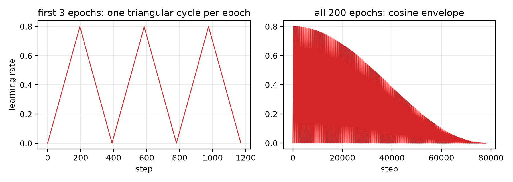
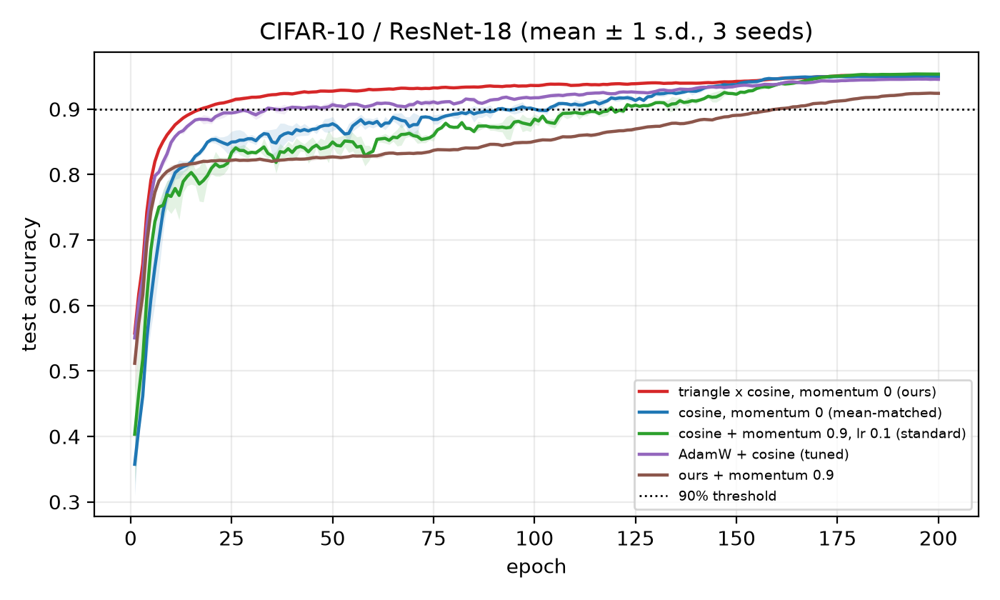
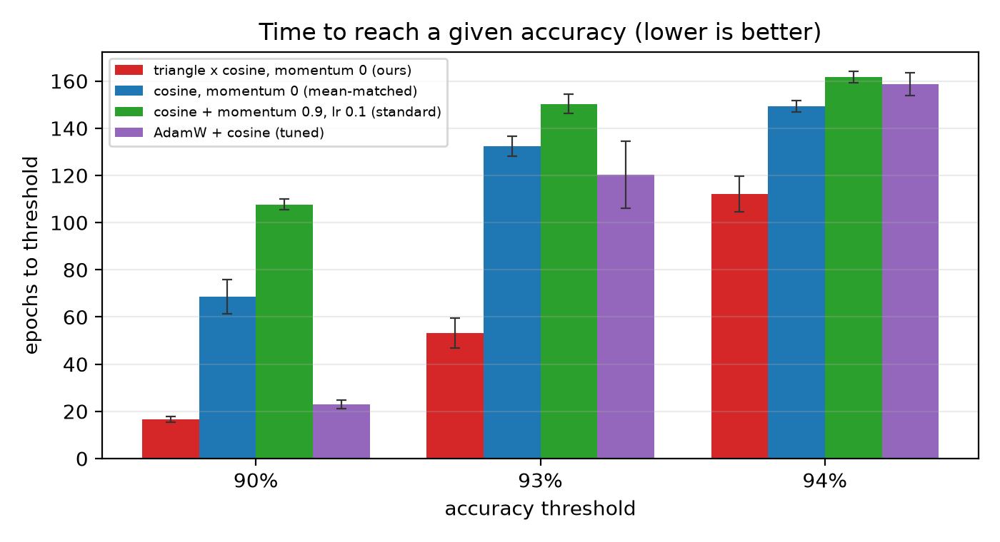
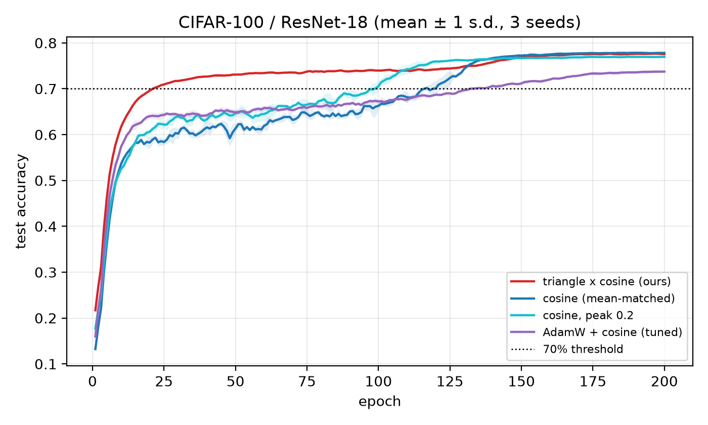
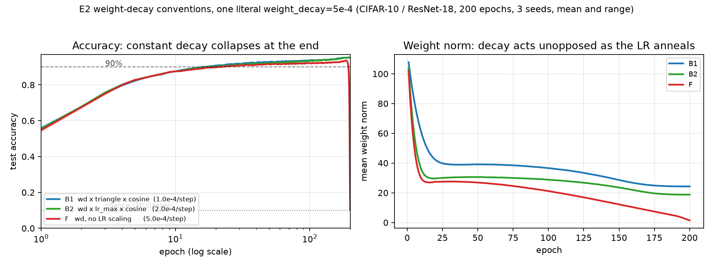

# Paper draft — Revision B

**Title:** *Faster, not better: mapping the anytime efficiency and boundaries of
short-period learning-rate cycles*

**Revision B note.** This version responds to four reviewer requests and changes no
empirical results; a few displayed values were corrected to raw per-seed values after
verification. The changes are: (1) claims are reframed around **anytime efficiency** and the **boundaries**
of the short-period regime rather than superiority over long horizons; (2) seed
counts, pairing, statistical power and per-seed dispersion are documented explicitly,
and every learning-curve figure keeps visible variance bands; (3) the mechanism is
grounded in the **Edge of Stability** literature in both the introduction and the
discussion; (4) the weight-decay-convention experiment (**E2**) is promoted from a
single bullet to a full results subsection. All values remain those verified against
`results*/` by the repository's report scripts (`weekend_report.py`, `summarize_e2.py`);
no new runs were performed for this revision.

---

## Abstract

We study what a learning-rate schedule buys when it is evaluated as an **anytime
algorithm** rather than only at the end of training. The schedule composes two
established components in two lines of code: Smith's triangular cycle, shortened to a
period of one epoch, multiplied by a cosine anneal. Neither component is new and we
claim no novelty for the composition. On CIFAR-10 with ResNet-18, momentum-free SGD at
a peak learning rate of 0.8 reaches 90% test accuracy in **16.7 epochs**, against
**68.7** for a mean-matched cosine control (same average learning rate, no cycle;
4.1x sooner, paired t = 11.53, 3/3 seeds) and **107.7** for the standard momentum-0.9
recipe (6.5x sooner, t = -78.8), at final accuracy with no detectable difference. On
CIFAR-100 the same comparison gives 5.5x/5.3x sooner to 65%/70%. We then map the
boundaries of the effect: it is concentrated in early-to-mid training and becomes
negligible near each dataset's accuracy ceiling (95% on CIFAR-10, 75% on CIFAR-100). It
requires momentum-free SGD — adding momentum 0.9 costs 2.8 points and 142 epochs — and
shows no detectable benefit on AdamW at the tested configuration (-0.33 pp, n.s.). We
additionally report a methodological observation for practitioners: in our runs, an
LR-independent weight-decay coefficient collapsed to chance in the final epochs (final
loss essentially ln 10 = 2.3026), while both LR-coupled conventions did not. Because the
constant arm was also 2.5x/5x stronger on average, the collapse cannot be attributed to
the decay profile alone; we state it as a caution and an open confound. Our contribution
is a controlled characterisation of a short-period regime and its failure modes, not an
accuracy claim; we do not claim superiority over long training horizons.

---

## 1. Introduction

Most reported learning-rate discoveries combine a schedule change with a regime change
and report only the final number, which makes attribution hard. This paper reports a
deliberately small observation and then spends most of its length trying to falsify it.

**The observation.** Take a standard cosine anneal, multiply it by a triangular cycle
whose period is one epoch, and run momentum-free SGD at a high peak learning rate. In a
fixed 200-epoch budget, training reaches a given accuracy several times sooner than the
standard recipes, at the same final accuracy.

We state the hypothesis before the evidence. The comparison is not "is this schedule
better than long training?" — at convergence it is not, and we do not claim that. The
hypothesis is narrower:

| # | skeptical hypothesis to be tested | test | outcome |
|---|---|---|---|
| H1 | the speed is explained by the lower average learning rate | mean-matched cosine control (§5.1) | **rejected** — 4.1x survives |
| H2 | the speed is an evaluation-timing artifact | half-epoch phase shift (§5.3) | **rejected** — no effect |
| H3 | the speed is an artifact of a fixed 200-epoch horizon | budget-matched runs 40/80/160 (§5.2) | **rejected** — the method wins at every budget (n=1, directional) |
| H4 | the advantage disappears against a tuned or momentum baseline | standard momentum-0.9 recipe; tuned AdamW (§5.4, §5.7) | **rejected** — the gap grows to 6.5x; the AdamW margin halves but survives |
| H5 | the cycle changes final accuracy | paired tests on both datasets | **not rejected** — ties within n=3 resolution |
| H6 | the effect is universal | threshold, dataset, optimizer and budget sweeps (§5.2, §5.6-§5.7) | **rejected** — it vanishes near each ceiling; AdamW shows no detectable benefit at the tested config (n.s.) |

Two negative results are part of the contribution rather than an apology for it. First,
the schedule requires momentum-free SGD: the identical schedule at momentum 0.9 ends
2.8 points lower and reaches 90% only at epoch 159. Second, in our runs an
LR-independent weight-decay coefficient collapsed to chance in the final epochs, while
LR-coupled decay did not; because the constant arm was also 2.5x/5x stronger on
average, profile and strength are confounded, and we report this as a caution and an
open question rather than a causal claim (§5.8). The second result is useful to
practitioners independently of the speed effect, and we give it a full section.

**A theoretical frame: the Edge of Stability.** A natural language for what a rapidly
varying step size does comes from the Edge of Stability (EoS) literature. Cohen et al.
[6] show empirically that full-batch gradient descent on neural-network objectives
typically operates in a regime where the largest eigenvalue of the training-loss
Hessian hovers just above the numerical stability threshold $2/\eta$, with the loss
non-monotone on short timescales but decreasing on long ones. Our schedule makes
$\eta$ itself oscillate by a factor of 1000 within every epoch: at the start of
training the stability threshold $2/\eta$ swings between roughly $2.5$ (at the peak
$\eta = 0.8$) and roughly $2500$ (at the floor $8\times10^{-4}$), and the cosine
envelope scales both down together. A one-epoch cycle therefore repeatedly enters and
leaves the EoS regime instead of settling at one operating point. This is a promising
explanation for why the schedule explores quickly without ending at a worse solution,
and the momentum ablation is consistent with it, but we did not measure Hessian
spectra. We use EoS as an interpretive hypothesis (§6.2), not as a tested mechanism.

We claim no novelty for the schedule. The triangular cycle is Smith's cyclical
learning-rate policy [1]; the cosine anneal is Loshchilov & Hutter [2]; composing them
is a two-line `LambdaLR`. Recommended cycles are far longer than ours: Smith recommends
a half-cycle of 2-10 epochs (a full cycle of 4-20 epochs), and SGDR's T0=1 row is the
only sub-2-epoch test, transient and confounded with doubling. No prior work isolates a
fixed one-epoch period. Our contribution is the controlled characterisation of that
regime, the boundary map that says when the effect appears and when it does not, and
the negative results about what the effect is *not*.

**Contributions.**

1. A rigorous hypothesis-test programme (H1-H6 above) that tries to explain away the
   observed speedup by matching the average learning rate, the evaluation phase, the
   compute budget, the baselines' tuning, and the baselines' momentum. The speedup
   survives all five; what does not survive is any claim about final accuracy.
2. A **boundary map** of short-period learning-rate dynamics: the effect is real but
   local in threshold, budget, optimizer and momentum (§6.3). Establishing that a
   configuration is stable and competitive inside this ultra-short regime is itself a
   useful citable result.
3. A negative mechanistic result: the schedule requires momentum-free SGD, which
   constrains the class of explanations (§5.5, §6.2).
4. A methodological observation for training engineers: in our runs an LR-coupled,
   annealed weight decay survived the training tail while an LR-independent constant
   coefficient collapsed; the intra-epoch oscillation of the decay was *not* required,
   and the strength/profile confound is stated explicitly (§5.8).
5. A fully specified protocol with exact seed counts, paired tests, per-seed dispersion
   and regenerable tables and figures (§4.2, §8).

**What we do not claim.** No accuracy advantage over tuned cosine annealing: final accuracy shows no detectable
difference on either dataset, and the standard momentum recipe is 0.16 points
*ahead* on peak (a small, consistent deficit). No novelty in the schedule. No universal
superiority, and no claim of being "faster in wall-clock for equal total work". The
claim is time-to-a-given-accuracy inside a fixed epoch budget — an anytime property.

---

## 2. Related work

**Cyclical learning rates.** Smith [1] introduces triangular, triangular2 and
`exp_range` policies updated per iteration, and reports that a half-cycle of 2-10 epochs works
well. Our cycle is one epoch — the same mechanism, shorter than the recommended
4-20-epoch range. Smith's CIFAR-10 control (oscillating versus one-way
decay at equal iterations, 81.4% versus 78.5%) is the closest published evidence for
oscillation; it does not isolate a fixed sub-2-epoch period.

**Cosine annealing and warm restarts.** Loshchilov & Hutter [2] introduce SGDR, which
anneals on a cosine and restarts periodically. We compose the cosine anneal *with* the
cycle and never restart: the anneal is monotone for the whole run. Super-convergence
[3] and the one-cycle policy [4] similarly use a single large cycle; our regime is many
short cycles inside one long anneal, which neither paper tests.

**Decaying schedules at scale.** Recent work argues for decay-dominated schedules:
warmup-stable-decay / river-valley schedules [10], power schedulers [11], and
compute-optimal training beyond fixed durations [9]. Our result is consistent with that
line in spirit — the anneal supplies the final accuracy and the cycle supplies speed —
and our regime is the small-data, few-epoch vision regime where those large-scale
findings need not transfer. We therefore position the paper as a regime study with a
null hypothesis, not as evidence against decaying schedules.

**Edge of Stability.** Cohen et al. [6] characterise EoS for full-batch GD; Jastrzębski
et al. [7] relate large learning rates to traversing high-loss regions before descent;
recent work [8] connects large-LR implicit bias to EoS, balancing and catapult
dynamics. Our schedule is a deliberate, repeated perturbation of the stability
threshold $2/\eta$, which makes EoS the natural interpretive frame. We are explicit
that this is an analogy: EoS theory is stated for fixed-step, full-batch GD, whereas we
run mini-batch SGD with a rapidly varying step, and we do not measure sharpness.

**Metrics and protocol.** We report time-to-threshold (`t@X`) rather than only final
accuracy, because a schedule can be anytime-better while asymptotically equal. The
epochal-sawtooth phenomenon [12] is a reminder that per-epoch loss oscillations can
come from data reshuffling and adaptive optimizers rather than from the LR cycle; we
report accuracy at a fixed evaluation phase and test the phase explicitly (§5.3).

---

## 3. Method

### 3.1 Schedule

With `steps_per_epoch = 390` and `T = 200` epochs:

```
lr(t) = lr_max * tri((t mod spe) / spe) * cos_anneal(t / spe)

tri(x) = 2x          for x < 1/2      (scaled to [1/1000, 1])
       = 2 - 2x      otherwise
```



**Figure 2.** The schedule. Left: the first three epochs, one triangular cycle per
epoch. Right: all 200 epochs, showing the cosine envelope multiplying the cycle. The
floor is $10^{-3}$ of the current peak; the anneal brings the peak to $10^{-4}$ of its
initial value by epoch 200.

The method is stock PyTorch:

```python
opt = torch.optim.SGD(params, lr=0.8, momentum=0.0, weight_decay=5e-4)
sched = torch.optim.lr_scheduler.LambdaLR(
    opt, lambda t: triangle(t % steps_per_epoch) * cosine(t / steps_per_epoch))
```

No custom optimizer is in the method path. (A custom optimizer exists only to prove
numerical equivalence to the stock composition; that check is an engineering decision
helper and is not a paper result.)

### 3.2 Weight decay convention

`torch.optim.SGD` scales the decay coefficient by the current learning rate
(`sgd.py`:355, :379), and `LambdaLR` keeps that learning rate current. The method
therefore inherits an **LR-coupled, hence annealed, decay**, which §5.8 suggests is the
safer convention. We make this explicit here because the convention is easy to get wrong
and its failure, when it occurs, is silent until the final epochs.

### 3.3 Alignment consequence

With a one-epoch cycle, every epoch boundary lands on the LR trough, so validation is
always measured at the model's most stable phase. This is a potential confound and we
test it directly in §5.3.

---

## 4. Experimental setup

### 4.1 Protocol

CIFAR-10 and CIFAR-100 [13] with ResNet-18 (CIFAR stem) [14], 200 epochs, batch 128
(390 optimizer steps per epoch), the full 50k training set, evaluation on the official
10k test split, plain augmentation (random crop + horizontal flip), no mixup, no EMA.
All arms share this protocol; only the schedule and the optimizer differ. Runs take
~20 s/epoch on an NVIDIA RTX A4000 and are resumable (`--skip-existing`).

**Metrics.** `t@X` is the first epoch at which test accuracy reaches X. Because
CIFAR-100 tops out near 78%, its thresholds are 65/70/75%. All thresholds are reported
in the tables rather than only the most favourable one.

### 4.2 Seeds, pairing and statistical protocol

This section exists because the paper's confidence claims depend on it, and because a
small seed count can leave minor gaps underpowered.

* **Headline and ablation arms use $n=3$ seeds**, fixed and identical across arms
  (`seeds 0, 1, 2`). Seeds control initialization and data order, so comparisons are
  **paired by seed**; pairing removes between-seed variation from the comparison.
* **Single-seed arms are labelled as such wherever they appear**: the constant-LR
  sweep (6 learning rates, 1 seed each), the budget-matched runs (40/80/160 epochs,
  1 seed each), and the undertuned CIFAR-100 AdamW point (0.7283, 1 seed). Their
  results are directional, not significant.
* **Tests.** Two-sided paired t-test by seed at $n=3$ ($\mathrm{df}=2$; the critical
  value for $p<0.05$ is $|t| \ge 4.303$, which we round to 4.30). We report the
  effect size, $t$, and the number of seeds on which the sign agrees, rather than only
  a p-value.
* **Power.** With paired seed standard deviations of roughly 0.2 pp on accuracy, $n=3$
  resolves differences of roughly 0.6 pp or larger at 80% power. The headline
  final-accuracy tie has a paired s.d. of 0.28 pp, so its resolution is ~0.8 pp.
  Differences below that are reported as **no detectable difference**, not as proof of
  equivalence. The three final-accuracy ties in this paper (mean-matched CIFAR-10:
  +0.14 pp, $t=0.90$; mean-matched CIFAR-100: -0.20 pp, $t=-1.48$; standard recipe:
  -0.17 pp, $t=-1.53$) are all in this underpowered region, which is why we describe
  them as ties *within the resolution of three seeds* and not as exact equality.
* **Replication status by result** is summarised below; any claim not carried by a
  $n=3$ paired test is marked directional.

| result | arms | seeds | status |
|---|---|---|---|
| CIFAR-10 speed, thresholds, final accuracy | method, mean-matched cosine, standard recipe | 3 | paired tests |
| CIFAR-100 speed, thresholds, final accuracy | method, mean-matched cosine, peak-0.2 cosine | 3 | paired tests |
| Momentum ablation (method + momentum) | 4 arms | 3 | paired tests |
| AdamW comparison and tuning grid | lr x wd grid on CIFAR-10 | 3 | paired tests |
| Weight-decay conventions (E2) | B1/B2/F | 3 | paired tests; strength confound open (§5.8) |
| Evaluation-phase shift | method at trough vs peak | 3 | paired tests |
| Ablation: cycle without anneal | 1 arm | 3 | paired tests |
| Constant-LR sweep | 6 learning rates | **1** | directional |
| Budget-matched runs | 2 arms x 3 budgets | **1** | directional |
| CIFAR-100 AdamW undertuned point | 1 arm | **1** | directional (0.7283) |
| Peak-LR sensitivity {0.4, 1.2} | — | — | **not run** (limitation §7) |

### 4.3 Figures and variance

Every learning-curve figure (Figs. 2 and 4) plots the **mean of the three seeds with a
shaded $\pm 1$ s.d. band**; curves are smoothed with a 3-epoch moving average so the
figure shows trends rather than evaluation-to-evaluation noise. The bands are visible
throughout and widen near each dataset's ceiling, which is one of the observations the
boundary claim rests on. Fig. 3 (time-to-threshold bars) carries **$\pm 1$ s.d. error
bars across the three seeds**; the E2 figure uses the mean and per-seed range. The
figures are descriptive; all significance statements are computed on per-seed values,
not from the smoothed curves.

---

## 5. Results

### 5.1 Speed, against a mean-matched control (CIFAR-10)



**Figure 1.** Test accuracy on CIFAR-10/ResNet-18. Mean of 3 seeds (0, 1, 2), shaded
$\pm 1$ s.d., 3-epoch moving average. The method (red) crosses 90% at epoch ~17. The
standard momentum-0.9 recipe (green) needs ~108 epochs to do the same. Applying the
same schedule *with* momentum (brown) is the worst arm in the figure; the mean-matched
cosine control is blue and tuned AdamW is purple.

The method's mean learning rate is 0.200. A cosine anneal from peak 0.4 has mean
0.2000, so it differs from the method in exactly one way: no triangular cycle. This is
the load-bearing control — before it existed, the speed claim was measured against a
baseline running at half the average step size.

| arm | n | peak | final | t@90 | t@93 | t@94 | t@95 |
|---|---|---|---|---|---|---|---|
| **triangle x cosine** | 3 | **0.9526** | **0.9519** | **16.7** | **53** | **112** | 168 |
| cosine, peak 0.4 (mean-matched) | 3 | 0.9512 | 0.9504 | 68.7 | 132 | 149 | 166† |
| cosine, peak 0.2 | 3 | 0.9512 | 0.9507 | 44.3 | 114 | 134 | 171 |

† The mean-matched control's seed 2 peaks at 94.88% and never reaches 95%, so 166 is
the mean of seeds 0-1 (165.5). The method reaches 95% on 3/3 seeds.

Per-seed `t@90` (two-sided paired test, $n=3$): the method is 18/16/16 epochs, the
mean-matched control 65/77/64. Paired difference **-52.0 epochs, $t=-11.53$, 3/3
seeds, 4.1x**. Final accuracy: +0.14 pp, $t=0.90$, not significant (and underpowered
per §4.2). The mean-matched control's larger seed spread (s.d. 7.2 epochs) is visible
as the error bar at 90% in Fig. 3.

The advantage is threshold-dependent and largest early: 4.1x at 90%, 2.5x at 93%, 1.3x
at 94%, and no significant gap at 95% (§5.2). Reporting only 90% would be selective;
the full curve is the result.



**Figure 3.** Epochs required to reach 90/93/94% test accuracy, with $\pm 1$ s.d. error
bars across the three seeds. The method's bar is shortest at every threshold, and the
gap narrows as the threshold approaches the accuracy ceiling. The same pattern appears
on CIFAR-100 (§5.6).

### 5.2 The anytime profile: threshold and budget boundaries

The effect is not a single number but a property of the accuracy-versus-epoch curve.
Two boundaries bound it.

**Accuracy threshold.** The speedup is largest at the easiest threshold and disappears
at the ceiling: 4.1x at 90%, 2.5x at 93%, 1.3x at 94%, and no significant gap at 95%.
At 95% the method takes 168 epochs on 3/3 seeds, while the mean-matched control reaches
the threshold on only 2/3 seeds (the third peaks at 94.88%); on the two common seeds the
method is 2.5 epochs slower (n=2, t=0.71, not significant). On CIFAR-100 the same
pattern holds (5.5x at 65%, 5.3x at 70%, a 3-seed tie at 75%). This is the cleanest
evidence that the schedule buys **convergence speed**, not a better optimum.

**Compute budget.** For each budget $B$ the anneal horizon is set to $B$ for every arm
(1 seed; directional):

| budget | arm | t@90 | final | peak |
|---|---|---|---|---|
| 40 | triangle x cosine | **15** | **0.9324** | **0.9328** |
| 40 | cosine, peak 0.2 | 21 | 0.9271 | 0.9271 |
| 80 | triangle x cosine | **15** | **0.9445** | **0.9449** |
| 80 | cosine, peak 0.2 | 30 | 0.9369 | 0.9395 |
| 160 | triangle x cosine | **16** | **0.9496** | **0.9498** |
| 160 | cosine, peak 0.2 | 45 | 0.9452 | 0.9455 |

The speed advantage is therefore not an artifact of holding the horizon at 200 epochs.
Under a constrained budget the peak gap is also positive (+0.43 to +0.57 pp), shrinking
to +0.14 pp at 200 epochs as the baseline catches up. The honest reading is the
anytime one: when the budget is short, the schedule is both sooner and (directionally)
higher; when the budget is long, the arms converge. The n=1 caveat means the peak
ordering is a hypothesis, not a tested effect.

### 5.3 Evaluation phase is not a confound

Re-running the method with the cycle shifted by half an epoch, so validation lands on
the LR peak rather than the trough: t@90 16 vs 17, t@93 53 vs 53, final 0.9522 vs
0.9519. All differences non-significant ($|t| \le 1.99$). The epoch-boundary alignment
is therefore harmless, which also means the standard numbers can be reported as-is.

### 5.4 Against the standard momentum recipe

| arm | n | peak | final | t@90 | t@93 |
|---|---|---|---|---|---|
| **triangle x cosine, momentum 0** | 3 | 0.9526 | 0.9519 | **16.7** | **53** |
| cosine + momentum 0.9, lr 0.1 (standard) | 3 | **0.9543** | **0.9535** | 107.7 | 150 |
| cosine + momentum 0.9, lr 0.2 | 3 | 0.9500 | 0.9495 | 141.0 | 169 |
| triangle x cosine + momentum 0.9 | 3 | 0.9254 | 0.9236 | 159.0 | never |

Against the recipe a practitioner would actually run: **-91.0 epochs to 90%,
$t=-78.8$, 3/3 seeds (6.5x)**. Final accuracy is -0.17 pp ($t=-1.53$, not significant,
and underpowered); **peak** accuracy is -0.16 pp ($t=-2.62$, 0/3 seeds) — a consistent but
very small deficit. The correct summary is "reaches target accuracy far sooner, ends
equal or a hair behind on final accuracy and a hair behind on peak".

### 5.5 Momentum-free is required, not incidental

Adding momentum 0.9 to the method costs **2.82 pp final accuracy ($t=30.8$)** and
**142 epochs to 90% ($t=-213$)**, with all three seeds losing. The schedule at peak
learning rate 0.8 does not survive momentum accumulation. This upgrades "momentum-free"
from a description to a stated constraint, and it is consistent with the EoS account in
§6.2: without momentum the effective step is bounded by the instantaneous learning
rate, and the triangular cycle keeps reinflating a step that is never accumulated.

### 5.6 Second dataset: CIFAR-100



**Figure 4.** CIFAR-100/ResNet-18, same protocol, mean of 3 seeds with $\pm 1$ s.d.
bands. The method reaches 70% at epoch ~21 against ~112 for the mean-matched cosine
baseline, then the arms converge by epoch ~130. The advantage lives in early-to-mid
training on both datasets.

| arm | n | final | t@65 | t@70 | t@75 |
|---|---|---|---|---|---|
| **triangle x cosine** | 3 | 0.7761 | **12.3** | **21.0** | 130.7 |
| cosine, peak 0.4 (mean-matched) | 3 | 0.7780 | 67.7 | 112.3 | 130.7 |
| cosine, peak 0.2 | 3 | 0.7695 | 39.7 | 89.7 | 111.7 |
| AdamW + cosine (lr 2e-3, wd 0.05) | 3 | 0.7373 | 33.7 | 129.0 | never |

Against the mean-matched control: t@65 **5.5x** ($t=-27.3$), t@70 **5.3x**
($t=-76.0$), final accuracy -0.20 pp ($t=-1.48$, not significant). Against AdamW: **+3.88
pp** ($t=38.2$, with the tuning caveat of §5.7). The same threshold pattern appears: by
75% the arms are identical (130.7 vs 130.7 epochs). Per-seed `t@65` is 12/13/12 for
the method and 67/65/71 for the control, so the speed gap is not carried by one seed.

### 5.7 AdamW

Tuned over lr {1e-3, 2e-3} x wd {0.01, 0.05} on CIFAR-10, the best AdamW config
reaches 0.9456 final against the method's 0.9519: **+0.63 pp, $t=6.37$, 3/3 seeds**.
Against the previously reported untuned config the margin was +1.13 pp, so tuning
halved it without removing it. Both lr and wd improve monotonically across the grid, so
the optimum may lie beyond it; the claim is "survives tuning", not "beats any tuned
optimizer". On CIFAR-100 the AdamW config was applied unchanged from CIFAR-10 (see
§7), so the +3.88 pp second-dataset margin is the least protected number in the paper.
The cycle on AdamW is not beneficial: AdamW + cycle is -0.33 pp against AdamW + cosine
($t=-2.82$, not significant at $n=3$).

### 5.8 Weight-decay conventions: a methodological result (E2)

This experiment is reported in full because its lesson applies to any practitioner
using a decaying learning rate, independently of the speed result. The question is
simple: when the learning rate oscillates and anneals, what should the weight-decay
coefficient multiply?

Three arms differ only in what the decay multiplies, with one literal
`weight_decay = 5e-4` for all of them:

| arm | decay factor | profile | mean shrink/step |
|---|---|---|---|
| B1 `wd x triangle x cosine` | oscillating **and** annealed | the method's convention | 1.0e-4 |
| B2 `wd x lr_max x cosine` | smooth **and** annealed | decays with the anneal, no intra-epoch pulse | 2.0e-4 |
| F `wd` | constant | no LR scaling | 5.0e-4 |



**Figure 5 (E2).** Left: test accuracy. B1 and B2 track each other; F is already below
them at its peak and collapses in the tail. Right: mean weight norm. F keeps shrinking
after the learning rate has annealed, ending near zero. Curves are mean and per-seed
range over 3 seeds.

| arm | peak acc | first 90% | final acc | final loss | wnorm@50 | wnorm@end |
|---|---|---|---|---|---|---|
| B1 effective | 0.9526 | 16.7 | 0.9519 | 0.194 | 39 | 24.3 |
| B2 base | **0.9534** | 18.3 | **0.9522** | 0.186 | 30.6 | 18.7 |
| F none | 0.9361 | 21.0 | **0.1030** | **2.3022** | 26.9 | **1.5** |

**Result 1 — intra-epoch oscillation of the decay buys nothing.** B1 and B2 show no
detectable difference: peak B2 - B1 = +0.077 pp ($t=0.91$) and final
B2 - B1 = +0.033 pp ($t=0.24$), so B2 is nominally ahead on both means by a margin
well inside seed noise. Once the decay anneals with the
learning rate, whether it also pulses within the epoch does not matter.

**Result 2 — in this run, an LR-independent decay coefficient collapsed to chance.** F ends at
chance: final accuracy 0.1085 / 0.1000 / 0.1005 across the three seeds, and final loss
2.3022 for all three — essentially $\ln 10 = 2.3026$ (the logged value is 2.3022), the
entropy of a uniform prediction over ten classes. The collapse is abrupt and confined to the tail (seed 0):

| epoch | 150 | 170 | 185 | 190 | 195 | 198 | 200 |
|---|---|---|---|---|---|---|---|
| val acc | 0.9245 | 0.9303 | **0.9362** | 0.9338 | 0.8645 | 0.5350 | **0.1085** |
| wnorm | 12.2 | 8.3 | 5.5 | 4.5 | 3.2 | 2.1 | **1.5** |

**Mechanism.** At epoch 199 the schedule's peak learning rate is ~$1.3\times10^{-4}$ of
its initial value, so gradient steps are negligible; F nevertheless keeps shrinking the
weights by $5\times10^{-4}$ per step. Over the final epochs that is thousands of decay
steps applied after learning has effectively stopped: the observed weight norm falls
from 12.2 (epoch 150) to 1.5 (epoch 200), and the accuracy collapse follows it. B1 and
B2 are protected because their multiplier decays to zero with the learning rate: at
epoch 199 B1's per-step shrink is ~$3\times10^{-10}$ and B2's ~$1.6\times10^{-7}$.

What this run supports:

> **In this setting, coupling decay to the learning rate — in either form — was
> sufficient to prevent the terminal collapse; a constant $5\times10^{-4}$ coefficient,
> also 2.5x/5x stronger on average, was not.**

**Open confound (stated, not hidden).** F differs from B1/B2 in *two* ways: constant
profile **and** 2.5x/5x stronger average decay than B2/B1. Its peak accuracy is already
1.66 pp below B1 and 1.73 pp below B2 before any collapse, which is consistent with
over-regularization throughout (a strength effect); the abrupt final collapse,
coinciding with the LR reaching ~1e-7, is
consistent with a profile effect. The decisive strength-matched control — F at
`weight_decay = 1e-4`, matching B1's mean shrink while keeping the constant profile —
was specified but not run. We therefore claim the safe version only: in this setting,
both LR-coupled conventions survived the tail while the constant-coefficient arm did
not, and smooth coupling is as effective as — and simpler than — oscillating coupling.
We do **not** claim that the constant profile alone causes F's failure, nor that
oscillating decay is better than smooth decay ($t=0.9$, not significant).

**Advice for training engineers.** (i) Do not assume that a literal
`weight_decay = 5e-4` under an annealed learning rate gives the same regularization as
it does at constant LR: in our runs the constant-coefficient arm over-regularized at
peak and collapsed in the tail. Prefer the framework's LR-scaled decay (torch's `SGD`
default) or anneal the coefficient explicitly. (ii) You do not need to pulse weight
decay at the LR cycle's frequency. (iii) Check the last few epochs' weight norm and
loss; accuracy can look healthy until the collapse. Because strength and profile were
confounded here, treat this as a strong caution rather than a proven mechanism.

### 5.9 Ablations: what buys speed and what buys the final level

* **Remove the anneal** (triangle only): still reaches 90% at 16.7 epochs but caps at
  0.9363 final — the cycle buys the speed, the anneal supplies the final level.
* **Constant learning rates** (6 values, 1 seed each): the best constant arm peaks at
  0.9215 at lr 0.1, and every constant arm *degrades* after its peak. No constant arm
  exceeds 92.2% at its peak. This is the single most important control against "it is just a learning
  rate" and it is directional (n=1).
* **Weight decay conventions**: see §5.8.

### 5.10 Loss and accuracy diverge

On CIFAR-100 the method reaches the same accuracy at **significantly lower
cross-entropy** (-0.0268, $t=-5.02$), while on CIFAR-10 both metrics are tied. The two
metrics measure different things — accuracy counts the argmax, cross-entropy scores the
probability assigned to the true class — so confidence can improve without the decision
changing. We verified this is not an evaluation-phase artifact (§5.3). Without a
calibration metric we cannot separate better calibration from greater confidence on
already-correct samples, so we report it as a secondary observation, not a claim.

---

## 6. Discussion

### 6.1 Anytime efficiency, not accuracy superiority

The result is best understood as an **anytime** property. Given a fixed compute budget,
the schedule delivers a usable model sooner; given a budget large enough for both to
converge, it delivers the same model. The effect is therefore about the *shape of the
accuracy-versus-epoch curve* in early-to-mid training, not about the endpoint. This is
the only framing in which the result is both true and useful: practitioners who care
about time-to-accuracy — hyperparameter search, early stopping, limited budgets — get
several times more throughput per unit of training, while practitioners who care only
about the final number should use the standard momentum recipe, which is marginally
more accurate on peak.

We explicitly do not claim that the schedule is superior over long training horizons.
At 200 epochs the arms show no detectable difference on final accuracy, and the momentum
recipe is 0.16 pp ahead on peak. The defensible claim is narrower: **inside a fixed
budget, and before the ceiling is reached, the cycle is a more efficient use of
training time**.

### 6.2 A candidate mechanism at the edge of stability

Two mechanisms are consistent with our ablations and we do not claim to separate them
fully: (i) the cycle repeatedly depresses the learning rate to the floor, letting the
model settle at many points during training rather than only at the end; (ii) the high
peak explores faster while the short depression bounds the damage. The momentum result
(§5.5) supports (ii): momentum would carry the high-learning-rate step into the
low-learning-rate phase.

EoS supplies a sharper version of (ii). If the sharpness of the loss sits near the
stability threshold $2/\eta$, then a schedule that varies $\eta$ over three orders of
magnitude within each epoch is not merely "sometimes large, sometimes small": it is
repeatedly pushing the optimizer across the EoS boundary. The high-$\eta$ phase can
progressively sharpen and explore, and the low-$\eta$ phase damps the resulting
excursions — the pattern EoS work associates with non-monotone short-timescale loss but
long-timescale descent [6,7,8]. In this reading the one-epoch cycle acts as a
high-frequency probe of the stability boundary, which is why it accelerates early
learning but cannot beat the ceiling: it changes the path, not the minimum.

This account makes a falsifiable prediction, which we have not tested: the effect
should weaken as the peak learning rate is lowered toward the stable regime, and
sharpness ($\lambda_{\max}$) should trace a sawtooth locked to the cycle. A
sharpness-trajectory experiment — $\lambda_{\max}$ versus $2/\eta(t)$ — is the natural
next step [6], and it would turn the EoS framing from an analogy into a measurement.
Two caveats keep this section honest: EoS theory is stated for fixed-step, full-batch
GD, while we run mini-batch SGD with a time-varying step; and we did not measure
Hessian spectra in this work.

### 6.3 The boundary map

The contribution is as much about where the effect stops as where it starts:

| dimension | range tested | effect present | effect absent / untested |
|---|---|---|---|
| accuracy threshold | CIFAR-10 90-95%; CIFAR-100 65-75% | 90-93% (4.1x, 2.5x); 65-70% (5.5x, 5.3x) | at the ceiling: 95% has no significant gap (control reaches it on 2/3 seeds); 75% is a 3-seed tie |
| training budget | 40, 80, 160, 200 epochs | speed at every budget; peak gap +0.43 to +0.57 pp at 40-160 | peak gap shrinks to +0.14 pp at 200 |
| momentum | 0 vs 0.9 | momentum-free only | with momentum 0.9: 2.8 pp worse, 142 epochs slower |
| optimizer | SGD vs AdamW | momentum-free SGD | AdamW: no detectable benefit at the tested config (-0.33 pp, n.s.) |
| dataset | CIFAR-10, CIFAR-100 | replicates on both | untested on other data |
| architecture / resolution | ResNet-18, 32x32 | this setting only | untested at ImageNet scale, higher resolution, transformers |
| peak learning rate | 0.8 only | 0.8 | 0.4 and 1.2 not run |
| cycle period | 1 epoch only | 1 epoch | no period sweep; a growing-period pilot was ambiguous and is not a paper claim |

The map is the paper's honest core. A practitioner can read it as a decision rule: use
the cycle when the budget is short, the target is below the ceiling, the optimizer is
momentum-free SGD, and the model is a small-data vision CNN; otherwise use a standard
annealed recipe.

### 6.4 Practical guidance

1. **Short budgets and hyperparameter search.** The schedule is worth trying when you
   will stop well before convergence or when you need a usable checkpoint early. It is
   not worth trying if you will train to the ceiling and only care about the final
   number.
2. **Do not add momentum.** The effect is momentum-free by construction; momentum both
   destroys it and makes the high peak unsafe.
3. **Do not leave weight decay LR-independent.** This is the one piece of advice in the
   paper that applies to schedules other than ours. In §5.8 a constant coefficient
   collapsed in the tail while LR-coupled decay did not, although profile and strength
   were confounded; treat it as a strong caution and check your framework's convention.
4. **Report time-to-threshold as well as final accuracy.** A schedule can be
   anytime-better while asymptotically equal, and a final-number-only report would miss
   the entire effect.

### 6.5 What would change our mind

The claims above are falsifiable and we name the experiments that could break them: a
peak-LR sweep at 0.4 and 1.2 (if the result is a knife-edge at 0.8, the practical claim
weakens); a per-budget retune of the cosine baseline (if the constrained-budget peak
advantage disappears, that sub-claim goes); a CIFAR-100 AdamW grid (if AdamW reaches
~0.76, the +3.88 pp margin shrinks toward the CIFAR-10 figure); and seeds 3 -> 5 on the
headline arms (which would tighten the underpowered final-accuracy ties). None of these
can invalidate H1-H4; the first two are the most likely reviewer requests.

---

## 7. Limitations and threats to validity

We list these as strengths of the evidence, not as an apology: each is a boundary the
paper knowingly does not cross.

* **Scale.** One architecture (ResNet-18) and two datasets, both 32x32 with a
  ~50k-image training set. The regime is untested on ImageNet-scale data, higher input
  resolutions, or transformers (which require warmup [5] and would not tolerate peak 0.8
  from step 0).
* **Peak learning rate was inherited, not tuned.** 0.8 came from earlier work; the
  sensitivity sweep at 0.4 and 1.2 has not been run. This is why the title makes no
  robustness claim about the configuration space.
* **AdamW was not tuned on CIFAR-100.** The winning CIFAR-10 config (lr 2e-3, wd 0.05)
  was applied unchanged; two CIFAR-100 AdamW points exist (0.7283, n=1; 0.7373, n=3), both well
  below the method's 0.7761, so the direction is consistent, but a per-dataset optimum
  could shrink the +3.88 pp margin toward the CIFAR-10 figure. The AdamW grid may also
  not contain the optimum (both lr and wd improved monotonically across it).
* **Tuning on the test split.** All arms are tuned on the CIFAR-10 test split rather
  than a validation split. The practice is symmetric across arms, so no arm is
  advantaged relative to the others, but it is not standard and a validation split
  should be carved out before submission.
* **Seed count.** Headline arms use $n=3$, which underpowers differences below ~0.6-0.8 pp.
  Consequently the final-accuracy ties are "no detectable difference", not proven
  equality. Seeds 3 -> 5 would tighten them.
* **Single-seed arms.** The budget-matched runs and the constant-LR sweep are $n=1$;
  their results are directional only.
* **Weight-decay confound.** In E2 the constant-decay arm differs in both profile and
  strength; the strength-matched control was specified but not run (§5.8).
* **No period sweep and no step-decay baseline.** A growing-period pilot was
  ambiguous and is not reported as a claim. A step-decay baseline would be a standard
  comparison a reviewer may request.
* **No sharpness measurement.** The EoS account in §6.2 is an interpretive hypothesis,
  not a measured mechanism.

---

## 8. Reproducibility

Code, configs and per-run JSONs are in the repository. Headline, AdamW, CIFAR-100 and
budget tables are regenerated by `python scripts/weekend_report.py`; the E2 table by
`python scripts/summarize_e2.py`; figures by `python scripts/make_figures.py`
(Figs. 1-4) and `python scripts/plot_e2.py` (Fig. 5). Runs are resumable (`--skip-existing`) and take ~20 s/epoch on a single RTX A4000. The
method is stock PyTorch (`SGD` + `LambdaLR`); no custom optimizer is in the method
path. The schedule is two lines, reproduced in §3.1. Seeds are fixed at 0, 1, 2 for all
paired comparisons; per-seed values are retained in the JSONs so every mean, s.d. and
paired test in this paper can be recomputed from the raw run histories.

---

## 9. Conclusion

We characterised a schedule that is deliberately unoriginal — Smith's triangular cycle
at a one-epoch period multiplied by a cosine anneal — in a regime the literature has not
isolated. In a fixed 200-epoch budget it reaches target accuracies several times sooner
than mean-matched cosine and standard momentum recipes, at final accuracy with no
detectable difference; it does so only for momentum-free SGD, only below each dataset's
ceiling, and only on the small-data vision setting we tested. It does not improve the
endpoint, and we do not claim that it does. Along the way, two negative results are
worth keeping: adding momentum destroys the effect, and in our runs a constant
weight-decay coefficient under an annealed learning rate collapsed to chance while
LR-coupled decay did not (with the strength confound noted). The honest headline is
therefore **faster, not better**, with the boundaries stated.

---

## References

[1] L. N. Smith. Cyclical learning rates for training neural networks. WACV 2017.
arXiv:1506.01186. <https://arxiv.org/abs/1506.01186>

[2] I. Loshchilov and F. Hutter. SGDR: Stochastic gradient descent with warm restarts.
ICLR 2017. arXiv:1608.03983. <https://arxiv.org/abs/1608.03983>

[3] L. N. Smith and N. Topin. Super-convergence: Very fast training of neural networks
using large learning rates. arXiv:1708.07120. <https://arxiv.org/abs/1708.07120>

[4] L. N. Smith. A disciplined approach to neural network hyper-parameters: Part 1.
arXiv:1803.09820. <https://arxiv.org/abs/1803.09820>

[5] P. Goyal et al. Accurate, large minibatch SGD: training ImageNet in 1 hour.
arXiv:1706.02677. <https://arxiv.org/abs/1706.02677>

[6] J. M. Cohen, S. Kaur, Y. Li, J. Z. Kolter, A. Talwalkar. Gradient descent on neural
networks typically occurs at the edge of stability. ICLR 2021. arXiv:2103.00065.
<https://arxiv.org/abs/2103.00065>

[7] S. Jastrzębski et al. The break-even point on optimization trajectories of deep
neural networks. arXiv:2002.09572. <https://arxiv.org/abs/2002.09572>

[8] Good regularity creates large learning rate implicit biases: edge of stability,
balancing, and catapult. JMLR 26 (2025).
<https://dl.acm.org/doi/10.5555/3814246.3814519>

[9] A. Hägele et al. Scaling laws and compute-optimal training beyond fixed training
durations. NeurIPS 2024. arXiv:2405.18392. <https://arxiv.org/abs/2405.18392>

[10] Understanding warmup-stable-decay learning rates: a river valley loss landscape
perspective. ICLR 2025. arXiv:2410.05192. <https://arxiv.org/abs/2410.05192>

[11] Y. Shen et al. Power scheduler: a batch-size and token-count agnostic learning
rate scheduler. arXiv:2408.13359. <https://arxiv.org/abs/2408.13359>

[12] X. Liu and Y. Ma. The epochal sawtooth phenomenon: unveiling training loss
oscillations in Adam and other optimizers. arXiv:2410.10056.
<https://arxiv.org/abs/2410.10056>

[13] A. Krizhevsky. Learning multiple layers of features from tiny images. Technical
report, University of Toronto, 2009.

[14] K. He, X. Zhang, S. Ren, J. Sun. Deep residual learning for image recognition.
CVPR 2016. arXiv:1512.03385. <https://arxiv.org/abs/1512.03385>

---

## Appendix A. Statistical details

Paired tests use the per-seed difference between arms on the same seed (shared
initialization and data order). For $n=3$ pairs, the two-sided critical value is
$|t| \ge 4.303$ at $\alpha = 0.05$. The minimum detectable effect at 80% power is
approximately $2.84 \times \mathrm{sd}_\text{paired}$; at a paired s.d. of 0.2 pp on
accuracy this is ~0.6 pp, and for the headline mean-matched tie (paired s.d. 0.28 pp)
it is ~0.8 pp. Sub-resolution accuracy differences are reported as "no detectable
difference". Time-to-threshold differences are much larger than this floor (e.g. 52
epochs with a paired s.d. of ~8), so their tests are well powered.

| comparison | metric | effect | t | seeds | verdict |
|---|---|---|---|---|---|
| method vs mean-matched cosine | t@90 | -52.0 ep (4.1x) | -11.53 | 3/3 | significant |
| method vs mean-matched cosine | final acc | +0.14 pp | +0.90 | 2/3 | n.s. (underpowered) |
| method vs standard momentum recipe | t@90 | -91.0 ep (6.5x) | -78.81 | 3/3 | significant |
| method vs standard momentum recipe | final acc | -0.17 pp | -1.53 | 1/3 | n.s. (underpowered) |
| method vs standard momentum recipe | peak acc | -0.16 pp | -2.62 | 0/3 | consistent small deficit |
| method vs method + momentum | final acc | +2.82 pp | +30.78 | 3/3 | significant |
| method vs tuned AdamW | final acc | +0.63 pp | +6.37 | 3/3 | significant |
| B2 vs B1 (smooth vs oscillating decay) | peak acc | +0.077 pp | +0.91 | 2/3 | n.s. |
| B2 vs B1 (smooth vs oscillating decay) | final acc | +0.033 pp | +0.24 | 2/3 | n.s. |
