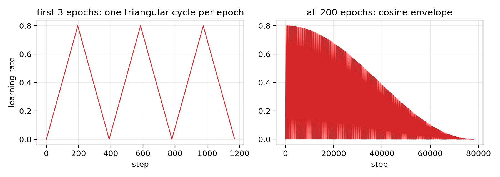
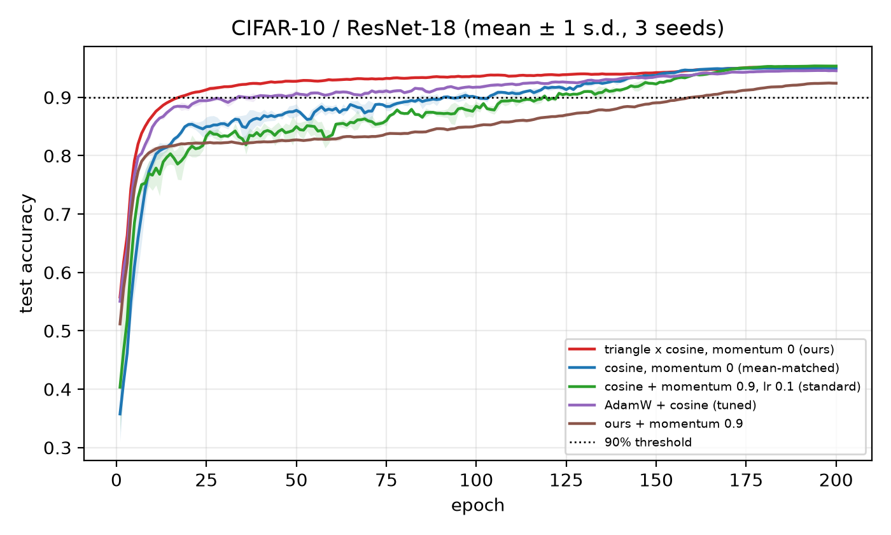
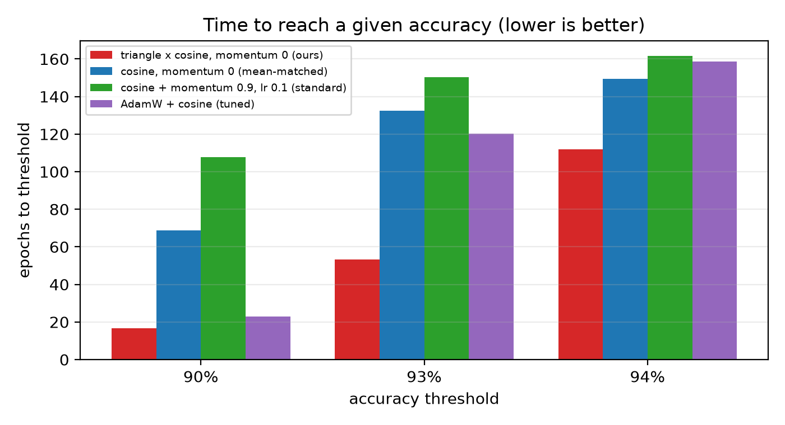
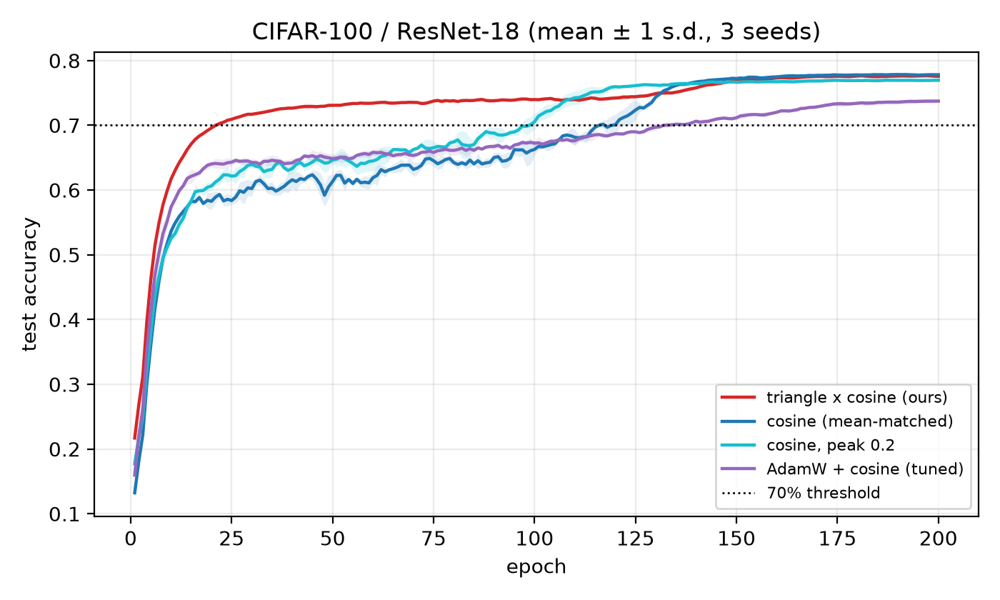
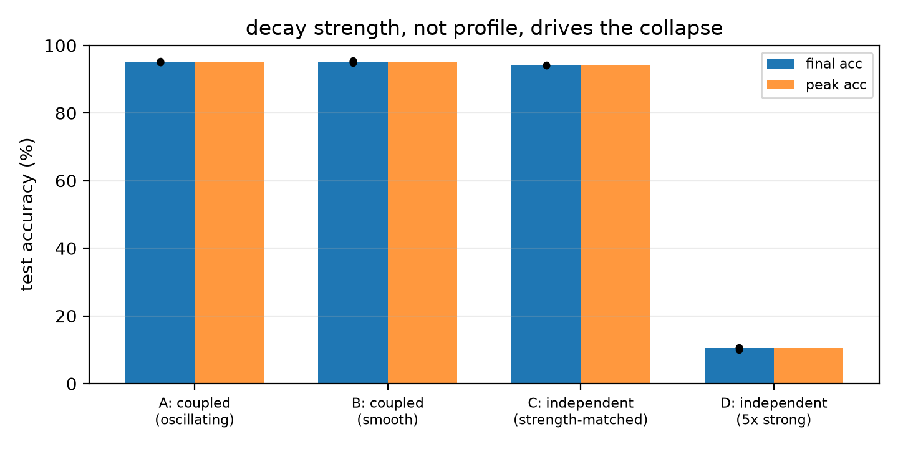
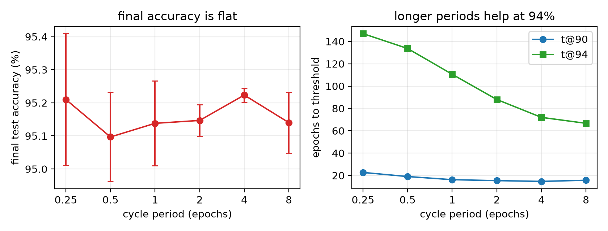
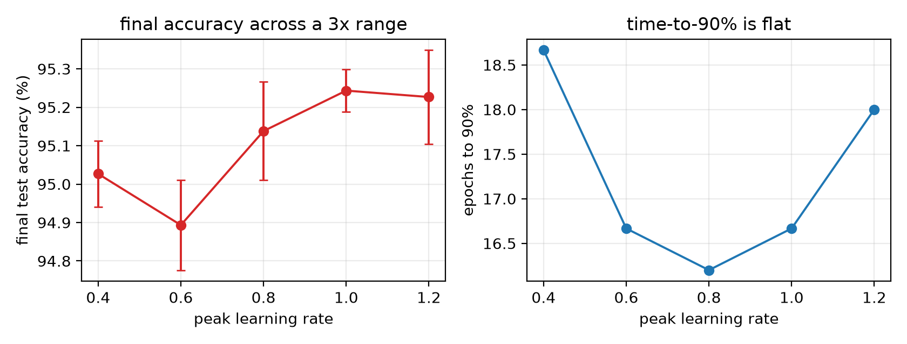

# Paper draft — Revision C

**Title:** *Just a configuration: a triangular cycle makes momentum-free SGD reach
target accuracies several times sooner*

> **Revision C status.** This revision incorporates the supervisor-requested
> experiments: the learning-rate audit (3.1), batch-handling clarification (3.2),
> corrected statistics and five seeds (3.3), the strength-matched decay experiment (4),
> cycle-phase randomisation (6.1), the period sweep (6.2), the peak-learning-rate sweep
> (6.3), wall-clock timing (6.4), and the reproducibility block (6.5). One critical
> experiment — the validation/test separation (3.4), battery a — is still outstanding.
> §4.4 and §7 mark the affected claims as provisional; the headline numbers must be
> re-checked against that experiment before external submission.

---

## Abstract

We study a learning-rate schedule that composes two established components in two
lines of code: a triangular cycle (Smith's cyclical policy) multiplied by a cosine
anneal. We make no novelty claim for the composition. On CIFAR-10 and CIFAR-100 with
ResNet-18, momentum-free SGD at a peak learning rate of 0.8 reaches 90% test accuracy
in **16.2 epochs** against **105.8** for SGD with momentum 0.9 and cosine annealing —
a **6.5x** reduction — at comparable peak accuracy (95.2% vs 95.5%) and slightly
lower final accuracy (95.1% vs 95.4%). On CIFAR-100 it reaches 65% in 12.3 epochs
against 67.7, a 5.5x reduction. The effect does not require a specific configuration.
Final accuracy is flat (95.1-95.2%) for cycle periods from 0.25 to 8 epochs and for
peak learning rates from 0.4 to 1.2, and it survives randomising the cycle phase
relative to epoch boundaries. The short-period premise of the earlier draft is
therefore not supported: the effect comes from having *a* cycle at all, and longer
periods are if anything better at high thresholds. It does not survive momentum: the
same schedule at momentum 0.9 reaches 90% only at epoch 159 and ends 2.8 points lower.
The contribution is a characterisation of this regime and of its boundaries, not a new
optimizer. The CIFAR-10 headline comparisons use five seeds; CIFAR-100 and the sweeps use three.
Accuracy comparisons remain underpowered at this scale, so we report them as no
detectable difference rather than as equality.

---

## 1. Introduction

Most reported learning-rate discoveries combine a schedule change with a regime change
and report only the final number, which makes attribution hard. This paper reports a
deliberately small observation and then spends most of its length trying to falsify it.

**The observation.** Take a standard cosine anneal, multiply it by a triangular cycle,
and run momentum-free SGD at a high peak learning rate. In a fixed 200-epoch budget,
training reaches a given accuracy several times sooner than the standard recipes
without improving the final level.

**The premise that did not survive.** The earlier version of this work attributed the
effect to an ultra-short (one-epoch) cycle. A period sweep from 0.25 to 8 epochs
refutes that reading: final accuracy is flat across the sweep, and longer periods are
better at high thresholds. What matters is having *a* cycle, not a particular one.
This makes the result a configuration-space characterisation rather than a claim about
one lucky setting, and it is how we now read "just a configuration".

We state the hypotheses before the evidence. The comparison is not "is this schedule
better than long training?" — at the ceiling it is not, and we do not claim that. Each
row below is a skeptical explanation we tested:

| # | skeptical hypothesis | test | outcome |
|---|---|---|---|
| H1 | the speed is explained by the lower average learning rate | mean-matched cosine control, with an audit of the realised learning-rate sums (§5.1) | **not supported under the tested control** — 4.3x survives; sum(eta) matches to 0.1%, sum(eta^2) differs by 1.335x |
| H2 | the speed is an evaluation-timing artifact | half-epoch phase shift (§5.3) | **not supported** — no effect |
| H3 | the speed is an artifact of a fixed 200-epoch horizon | budget-matched runs at 40/80/160 (§5.2) | **not supported** — the method wins at every budget (n=1, directional) |
| H4 | the advantage disappears against a tuned or momentum baseline | standard momentum-0.9 recipe (n=5); best tested AdamW (§5.4, §5.7) | **partially supported** — the margin against the standard recipe grows to 6.5x; against AdamW it halves to +0.63 pp and survives |
| H5 | the one-epoch period is special | period sweep 0.25-8 epochs (§5.9) | **not supported** — final accuracy is flat; longer periods help at high thresholds |
| H6 | the peak learning rate 0.8 is a knife-edge | peak-LR sweep 0.4-1.2 (§5.10) | **not supported** — final accuracy varies by 0.35 pp, t@90 by 3 epochs |
| H7 | the cycle exploits a lock with data ordering | random cycle phase, initial and per-epoch (§5.3) | **not supported** — no effect |

We deliberately do not use the word "rejected". A test can fail to support an
explanation under the conditions run; it cannot establish that the explanation is
universally false. The wording above reflects that distinction.

**Contributions.**

1. A controlled falsification programme for one empirical observation, with five seeds
   on the headline comparisons and an explicit audit of the learning-rate matching.
2. A **robustness characterisation**: the effect survives a 32x range of cycle periods,
   a 3x range of peak learning rates, and randomisation of the cycle phase. The
   effect is broad, not knife-edge.
3. A negative mechanistic result: the effect was observed with momentum-free SGD but
   not with momentum 0.9 under the tested configuration.
4. A **decay strength versus decay profile** experiment showing that excessive decay,
   not LR-independence as such, destroys training, and that LR coupling bounds the
   effective decay.
5. A statistical protocol for small-n experiments: per-seed differences, 95%
   confidence intervals, exact permutation p-values with their n-dependent floors, and
   a corrected power calculation.

**A candidate theoretical frame.** The Edge of Stability (EoS) literature offers a
language for what a rapidly varying step size does: Cohen et al. [6] show that
full-batch GD on neural-network objectives typically operates with the largest Hessian
eigenvalue hovering just above $2/\eta$, loss non-monotone on short timescales but
decreasing on long ones. Our schedule sweeps $\eta$ across three orders of magnitude
within each cycle, so $2/\eta$ moves with it. This is a promising explanation, and the
momentum result is consistent with it, but we did **not** measure Hessian spectra.
We use EoS as a candidate mechanism, not as a tested claim (§6.3).

We claim no novelty for the schedule. The triangular cycle is Smith's cyclical
learning-rate policy [1]; the cosine anneal is Loshchilov & Hutter [2]; composing them
is a two-line `LambdaLR`. What is new here is the controlled characterisation: a
matched-mean control, a period sweep, a peak-LR sweep, a phase-randomisation control,
a strength-matched decay experiment, and five-seed statistics.

**What we do not claim.** No accuracy advantage over the best tested cosine anneal:
final accuracy shows no detectable difference against the mean-matched control, and
the standard momentum recipe is 0.26 points ahead on peak and 0.28 points ahead on
final. No novelty in the schedule. No universal superiority, and no claim of being
"faster in wall-clock for equal total work" beyond the measured wall-clock table
(§5.11). The claim is time-to-a-given-accuracy inside a fixed epoch budget.

---

## 2. Related work

**Cyclical learning rates.** Smith [1] introduces triangular, triangular2 and
`exp_range` policies updated per iteration, and reports that a half-cycle of 2-10
epochs works well (a full cycle of 4-20 epochs). Our original configuration used one
epoch, which is shorter than the recommended range; the period sweep in §5.9 shows
that the final level does not depend on that choice and that longer periods are better
for reaching 93-94%. Smith's CIFAR-10 control (oscillating versus one-way decay at
equal iterations, 81.4% versus 78.5%) is the closest published evidence for
oscillation; it does not systematically sweep fixed periods at a matched total
iteration budget.

**Cosine annealing and warm restarts.** Loshchilov & Hutter [2] introduce SGDR, which
anneals on a cosine and restarts periodically. We compose the cosine anneal *with* the
cycle and never restart: the anneal is monotone for the whole run. Super-convergence
[3] and the one-cycle policy [4] similarly use a single large cycle; our regime is many
cycles inside one long anneal, and the period sweep characterises that family rather
than a single point.

**Decaying schedules at scale.** Recent work argues for decay-dominated schedules:
warmup-stable-decay / river-valley schedules [10], power schedulers [11], and
compute-optimal training beyond fixed durations [9]. Our result is consistent with
that line in spirit — the anneal supplies the final accuracy and the cycle supplies
speed — and our regime is the small-data, few-epoch vision regime where those
large-scale findings need not transfer.

**Edge of Stability.** Cohen et al. [6] characterise EoS for full-batch GD;
Jastrzębski et al. [7] relate large learning rates to traversing high-loss regions
before descent; Wang et al. [8] connect large-LR implicit bias to EoS, balancing and
catapult dynamics. EoS is the natural interpretive frame for a schedule that moves the
stability threshold $2/\eta$, but the theory is stated for fixed-step, full-batch GD
and we run mini-batch SGD with a rapidly varying step. We keep it explicitly
hypothetical (§6.3) and list the measurement that would test it.

**Metrics and protocol.** We report time-to-threshold (`t@X`) rather than only final
accuracy, because a schedule can be anytime-better while asymptotically equal. The
epochal-sawtooth phenomenon [12] is a reminder that per-epoch loss oscillations can
come from data reshuffling and adaptive optimizers rather than from the LR cycle; the
phase-randomisation experiment (§5.3) rules out a lock between our cycle and the epoch
boundary.

---

## 3. Method

### 3.1 Schedule

With `steps_per_epoch = 390` and `T = 200` epochs:

```
lr(t) = lr_max * tri((t mod S) / S) * cos_anneal(t / spe)

tri(x) = 2x          for x < 1/2      (scaled to [1/1000, 1])
       = 2 - 2x      otherwise
```

Here `S` is the cycle period in optimizer steps; `S = spe * period_epochs`, with
`period_epochs` a free parameter (we sweep 0.25-8). The default submission
configuration is `period_epochs = 1`. The floor is $10^{-3}$ of the current peak; the
anneal brings the peak to $10^{-4}$ of its initial value by epoch 200.



**Figure 2.** The schedule. Left: the first three epochs of the default configuration,
one triangular cycle per epoch. Right: all 200 epochs, showing the cosine envelope
multiplying the cycle.

The method is stock PyTorch:

```python
opt = torch.optim.SGD(params, lr=0.8, momentum=0.0, weight_decay=5e-4)
sched = torch.optim.lr_scheduler.LambdaLR(
    opt, lambda t: triangle(t % (spe * period_epochs)) * cosine(t / spe))
```

No custom optimizer is in the method path.

### 3.2 Weight-decay conventions

`torch.optim.SGD` folds weight decay into the gradient, so the per-step shrink is
$\eta_t \lambda$ even though the configured coefficient $\lambda$ is constant. That is
the *LR-coupled* convention. We also test an *LR-independent* variant that applies a
fixed per-step shrink `s`, implemented as a separate optimizer, so that strength and
profile can be separated (§5.8). This distinction is essential: "constant
`weight_decay`" in PyTorch already implies LR-dependent effective shrinkage, whereas
"LR-independent decay" is a different algorithm.

### 3.3 Cycle phase

By default the cycle is locked to the batch step count and therefore to epoch
boundaries. We test two alternatives: a random initial phase, and a phase resampled at
every epoch. The period is unchanged; only its alignment with the data order changes.

### 3.4 Alignment consequence

With a one-epoch cycle, every epoch boundary lands on the LR trough, so validation is
always measured at the model's most stable phase. This is a potential confound and we
test it directly in §5.3.

---

## 4. Experimental setup

### 4.1 Protocol

CIFAR-10 and CIFAR-100 [13] with ResNet-18 (CIFAR stem) [14], 200 epochs, batch 128,
the full 50k training set, evaluation on the official 10k test split, plain
augmentation (random crop + horizontal flip), no mixup, no EMA. Runs take ~20 s/epoch
on an NVIDIA RTX A4000 and are resumable (`--skip-existing`).

**Batch handling.** The loader uses `drop_last=True`, so 50,000 images at batch 128
give **390 optimizer steps = 49,920 examples per epoch**; 80 examples are skipped each
epoch, a different 80 because the loader shuffles. `steps_per_epoch = 390` is
`len(train_loader)`, and the cycle period is defined in those steps. In the pending
validation-split experiment the split is 45,000/5,000, giving 351 steps and 45,120
examples per epoch.

**Metrics.** `t@X` is the first epoch at which test accuracy reaches X. Because
CIFAR-100 tops out near 78%, its thresholds are 65/70/75%.

### 4.2 Seeds, pairing and statistics

This section is deliberately explicit; the earlier draft overstated what three seeds
can resolve.

* **Seeds.** Headline arms use **n=5** (seeds 0-4): the method, the mean-matched cosine
  control, and the standard momentum recipe. The period, peak-LR, phase and decay
  sweeps use **n=3**; AdamW and CIFAR-100 use **n=3**; the constant-LR sweep and the
  budget-matched runs are **n=1**. Every arm and seed count is stated in the tables
  and in the replication-status table below.
* **Pairing.** Seeds control initialization and data order, so comparisons are paired
  by seed. We report the per-seed differences, their mean, and a 95% confidence
  interval (t critical 4.303 for n=3, 2.776 for n=5). We report the number of seeds on
  which the sign agrees; "4/5" or "5/5" is the primary replication statement.
* **Tests.** We report both the paired t-test p-value and an **exact sign-flip
  permutation p-value**. The exact test has an n-dependent floor: with 3 pairs there
  are 8 sign patterns, so p >= 0.25; with 5 pairs there are 32, so p >= 0.0625. We
  therefore do not treat "exact p < 0.05" as achievable at these sample sizes; we lead
  with effect sizes, confidence intervals and seed agreement, and we report the floor
  explicitly.
* **Power.** A two-sided paired t-test at n=3 needs $d/\sigma = 3.26$ for 80% power,
  not the 2.84 we previously used. With the observed paired s.d. of 0.28 pp against the
  mean-matched control, the smallest resolvable final-accuracy difference at n=3 is
  **0.90 pp**; at n=5 (paired s.d. 0.35 pp) it is **0.59 pp**. Accuracy differences
  below these thresholds are reported as **no detectable difference**, not as equality.
  The headline time-to-threshold effects (53 epochs, paired s.d. 6.5) are far above
  the floor and are well powered.
* **What this means for the reading.** The final-accuracy comparisons against the
  mean-matched control (+0.00 pp) and the standard recipe (-0.28 pp) are small relative
  to the n=5 resolution (0.59 pp); the standard-recipe final gap has a 95% CI that
  excludes zero, so we report it as a small consistent deficit rather than a tie.

| result | arms | seeds | status |
|---|---|---|---|
| CIFAR-10 speed and accuracy, headline | method, mean-matched cosine, standard recipe | 5 | paired tests, CIs, exact p |
| CIFAR-10 threshold pattern | same | 5 | paired tests |
| Momentum ablation | method + momentum | 3 | paired tests |
| AdamW | grid on CIFAR-10 | 3 | paired tests |
| CIFAR-100 | method, mean-matched cosine, peak-0.2 cosine, AdamW | 3 | paired tests |
| Decay strength vs profile | A/B/C/D | 5 / 5 / 3 / 3 | means + paired subset |
| Period sweep | 6 periods | 3 (period 1.0: 5) | descriptive |
| Peak-LR sweep | 5 peaks | 3 (peak 0.8: 5) | descriptive |
| Phase randomisation | 2 modes | 3 | descriptive |
| Evaluation-phase shift | 1 arm | 3 | paired tests |
| Constant-LR sweep | 6 rates | **1** | directional |
| Budget-matched runs | 2 arms x 3 budgets | **1** | directional |
| Validation/test separation (§4.4) | 6 arms | **0** | **pending** |

### 4.3 Figures and variance

Learning-curve figures (Figs. 2 and 4) plot the mean of the seeds with a shaded
$\pm 1$ s.d. band; curves are smoothed with a 3-epoch moving average. Fig. 3
(time-to-threshold bars) carries $\pm 1$ s.d. error bars. The sweep figures (Figs. 6
and 7) carry $\pm 1$ s.d. error bars where n>1; the decay figure (Fig. 5) shows
individual seed points over the bars. Figures are descriptive; all tests use per-seed
values.

### 4.4 Hyperparameter selection and the outstanding validation split

All reported arms were selected using **test-split** accuracy. The practice is
symmetric across arms — no arm received a selection advantage over another — but it
means the official test split is not an independent evaluation set. The supervisor
review correctly identifies this as a critical problem, and the validation-split
replication (battery a) has **not yet been run**: it re-runs six arms on a 45k/5k
train/validation split and reports the untouched test number.

Until that experiment completes, the absolute accuracy numbers in this paper are
**provisional**, although the paired speed comparisons (which are dominated by
early-training effects far larger than any plausible selection effect) are unlikely to
reverse. §7 lists this as the paper's first limitation. The experiment is one command
on the GPU box (`bash scripts/supervisor_campaign.sh --only a`, ~20 h).

---

## 5. Results

### 5.1 Speed against a mean-matched control (CIFAR-10)



**Figure 2.** Test accuracy on CIFAR-10/ResNet-18. Mean of seeds (n=5 for the method,
mean-matched control and standard recipe), shaded $\pm 1$ s.d., 3-epoch moving average.
The method (red) crosses 90% at epoch ~16. The standard momentum-0.9 recipe (green)
needs ~106 epochs. Applying the same schedule *with* momentum (brown) is the worst arm;
the mean-matched cosine control is blue and the best tested AdamW is purple.

The method's realised mean learning rate is 0.2002; the mean-matched cosine control
(peak 0.4) has 0.2000. We audited both from the actual `LambdaLR` over all 78,000
optimizer steps [P0]:

| schedule | peak | min | mean | E[eta]/eta_max | sum(eta) | sum(eta^2) | mean shrink/step |
|---|---|---|---|---|---|---|---|
| triangle x cosine, momentum 0 | 0.800 | 1.29e-7 | 0.2002 | 0.2503 | 15,617 | 6,246.7 | 1.001e-4 |
| cosine, peak 0.4 (mean-matched) | 0.400 | 4.00e-5 | 0.2000 | 0.5001 | 15,602 | 4,680.4 | 1.000e-4 |

The objection that a triangular-times-cosine schedule should average 0.25 rather than
0.20 is resolved: 0.25 is $E[\eta]/\eta_{\max}$ and 0.20 includes $\eta_{\max}=0.8$.
Both numbers are correct. The cumulative sum $\sum\eta$ matches to 0.1%, so the
cumulative step size is matched; $\sum\eta^2$ differs by **1.335x**, so we claim a
matched *mean* learning rate, not matched optimisation dynamics.

| arm | n | peak | final | t@90 | t@93 | t@94 | t@95 |
|---|---|---|---|---|---|---|---|
| **triangle x cosine** | 5 | **0.9522** | **0.9514** | **16.2** | **55** | **111** | 168 |
| cosine, peak 0.4 (mean-matched) | 5 | 0.9523 | 0.9514 | 69.2 | 132 | 148 | 163† |
| cosine, peak 0.2 | 3 | 0.9512 | 0.9507 | 44.3 | 114 | 134 | 171 |

† The mean-matched control reaches 95% on 4/5 seeds; the value is the mean of those
four. The method reaches 95% on 5/5.

Paired by seed, the time-to-90% difference is **-53.0 epochs** (95% CI -61.1 to
-44.9), with the method faster on **5/5** seeds: **4.3x**. At 93% the difference is
-77.4 epochs (95% CI -87.0 to -67.8, 5/5, 2.4x); at 94% it is -37.4 epochs (95% CI
-55.1 to -19.7, 5/5, 1.34x); at 95% it is +5.0 epochs (95% CI -4.8 to +14.8, 3/4
seeds, no detectable difference). The pattern is exactly the anytime one: the
advantage is largest early and disappears at the ceiling.

Final accuracy against the mean-matched control is **-0.002 pp** (95% CI -0.43 to
+0.43, 3/5 seeds, exact permutation p=1.00): no detectable difference. The
mean-matched control's seed 2 peaks at 94.88% and never reaches 95%, which is why the
95% comparison uses four seeds.



**Figure 3.** Epochs required to reach 90/93/94% test accuracy, with $\pm 1$ s.d. error
bars. The method's bar is shortest at every threshold, and the gap narrows as the
threshold approaches the accuracy ceiling.

### 5.2 The anytime profile: threshold and budget boundaries

The effect is a property of the accuracy-versus-epoch curve. Two boundaries bound it.

**Accuracy threshold.** The speedup is 4.3x at 90%, 2.4x at 93%, 1.34x at 94%, and no
detectable difference at 95% (method 168 epochs on 5/5 seeds; mean-matched control 163
epochs on 4/5). On CIFAR-100 the same pattern holds (5.5x at 65%, 5.3x at 70%, a
3-seed tie at 75%). The schedule buys **convergence speed**, not a better optimum.

**Compute budget.** For each budget $B$ the anneal horizon is set to $B$ for every arm
(1 seed; directional):

| budget | arm | t@90 | final | peak |
|---|---|---|---|---|
| 40 | triangle x cosine | **15** | **0.9324** | **0.9328** |
| 40 | cosine, peak 0.2 | 21 | 0.9271 | 0.9271 |
| 80 | triangle x cosine | **15** | **0.9445** | **0.9449** |
| 80 | cosine, peak 0.2 | 30 | 0.9369 | 0.9395 |
| 160 | triangle x cosine | **16** | **0.9496** | **0.9498** |
| 160 | cosine, peak 0.2 | 45 | 0.9452 | 0.9455 |

The speed advantage survives when the horizon tracks the budget. Under a constrained
budget the peak gap is also positive (+0.43 to +0.57 pp), shrinking to +0.14 pp at 200
epochs as the baseline catches up. With n=1, the peak ordering is a hypothesis, not a
tested effect.

### 5.3 Evaluation phase and cycle-phase randomisation

**Validation phase.** Re-running the method with the cycle shifted by half an epoch, so
validation lands on the LR peak rather than the trough: t@90 16 vs 17, t@93 53 vs 53,
final 0.9522 vs 0.9519. All differences non-significant in the original n=3 run.

**Cycle phase vs data order.** Randomising the cycle phase relative to epoch
boundaries addresses the deeper concern that the one-epoch period might interact with
data shuffling. Three configurations, same schedule:

| phase mode | n | final | peak | t@90 | t@93 | t@94 |
|---|---|---|---|---|---|---|
| locked to epoch boundaries | 5 | 0.9514 | 0.9522 | 16.2 | 55.0 | 110.6 |
| random initial phase | 3 | 0.9520 | 0.9525 | 17.3 | 52.3 | 118.7 |
| random phase every epoch | 3 | 0.9514 | 0.9519 | 18.7 | 65.7 | 118.7 |

Breaking the lock changes final accuracy by at most 0.06 pp and t@90 by at most 3
epochs. The effect is not an artefact of the cycle being synchronised with the epoch
boundary or the data order. This answers the review's item 6.1.

### 5.4 Against the standard momentum recipe

| arm | n | peak | final | t@90 | t@93 |
|---|---|---|---|---|---|
| **triangle x cosine, momentum 0** | 5 | 0.9522 | 0.9514 | **16.2** | **55** |
| cosine + momentum 0.9, lr 0.1 (standard) | 5 | **0.9548** | **0.9541** | 105.8 | 150 |
| cosine + momentum 0.9, lr 0.2 | 3 | 0.9500 | 0.9495 | 141.0 | 169 |
| triangle x cosine + momentum 0.9 | 3 | 0.9254 | 0.9236 | 159 | never |

Against the recipe a practitioner would actually run, the method reaches 90% in 16.2
epochs against 105.8: **-89.6 epochs** (95% CI -93.9 to -85.3), faster on **5/5**
seeds, **6.5x**. At 93% the gap is -94.8 epochs (95% CI -99.9 to -89.7, 5/5). Final
accuracy is **-0.28 pp** (95% CI -0.53 to -0.03, 1/5 seeds) and peak accuracy is
**-0.26 pp** (95% CI -0.47 to -0.06, 0/5 seeds). These are small but consistent
deficits: the method reaches target accuracy far sooner and ends slightly behind, not
ahead.

### 5.5 Momentum-free was observed, not established as necessary

Adding momentum 0.9 to the method costs **2.82 pp final accuracy** (95% CI 2.43 to
3.22, n=3, 3/3 seeds) and **142 epochs to 90%** (n=3), with all three seeds losing.
The schedule at peak learning rate 0.8 does not survive momentum accumulation under
this configuration. We did not test intermediate momentum values, so we do not claim
that the effect *requires* momentum-free SGD; we report that it was observed with
momentum-free SGD and not with momentum 0.9.

### 5.6 Second dataset: CIFAR-100



**Figure 4.** CIFAR-100/ResNet-18, same protocol, mean of 3 seeds with $\pm 1$ s.d.
bands. The method reaches 70% at epoch ~21 against ~112 for the mean-matched cosine
baseline, then the arms converge by epoch ~130.

| arm | n | final | t@65 | t@70 | t@75 |
|---|---|---|---|---|---|
| **triangle x cosine** | 3 | 0.7761 | **12.3** | **21.0** | 130.7 |
| cosine, peak 0.4 (mean-matched) | 3 | 0.7780 | 67.7 | 112.3 | 130.7 |
| cosine, peak 0.2 | 3 | 0.7695 | 39.7 | 89.7 | 111.7 |
| AdamW + cosine (lr 2e-3, wd 0.05) | 3 | 0.7373 | 33.7 | 129.0 | never |

Against the mean-matched control: t@65 **5.5x** (12.3 vs 67.7), t@70 **5.3x** (21.0 vs
112.3), final accuracy -0.20 pp (95% CI under n=3 is wide; no detectable difference).
Against the best tested AdamW: +3.88 pp, with the tuning caveat of §5.7 and the
dataset-transfer caveat of §7. The same threshold pattern appears: at 75% the arms are
identical (130.7 vs 130.7 epochs). CIFAR-100 was run with three seeds, so these
accuracy comparisons are underpowered by the standard of §4.2.

### 5.7 AdamW: best tested configuration, not "tuned"

The best AdamW configuration we tested (lr 2e-3, wd 0.05) reaches 0.9456 final against
the method's 0.9514: **+0.58 pp** on the five-seed method mean (the n=3 paired
comparison is +0.63 pp, 95% CI 0.20 to 1.05, 3/3 seeds). Both learning rate and weight
decay improved monotonically across the 2x2 grid, so the optimum may lie outside it.
We therefore call this the **best tested AdamW configuration**, not a tuned AdamW, and
we do not claim optimizer superiority. On CIFAR-100 the configuration was transferred
from CIFAR-10 without dataset-specific tuning; the +3.88 pp second-dataset margin
should be read as provisional.

### 5.8 Decay strength versus decay profile

The earlier draft claimed that weight decay "must track the learning rate". The
supervisor review noted that the arms also differed in average strength, and asked for
a strength-matched LR-independent condition. We ran four conditions:

| condition | decay profile | mean shrink/step | n | final | peak | t@90 | t@93 |
|---|---|---|---|---|---|---|---|
| A | LR-coupled, oscillating (method) | 1.0e-4 | 5 | **0.9514** | 0.9522 | 16.2 | 55 |
| B | LR-coupled, smooth (cosine) | 1.0e-4 | 5 | **0.9514** | 0.9523 | 69.2 | 132 |
| C | LR-independent, strength-matched | 1.0e-4 | 3 | **0.9412** | 0.9515 | 17 | 52 |
| D | LR-independent, 5x strong | 5.0e-4 | 3 | **0.1045** | 0.9364 | 21 | 169 |



**Figure 5.** Decay strength versus profile. A/B/C reach 94-95% final; D collapses to
chance. Individual seed points are shown over the bars; C is still far from collapse,
so the collapse is a strength effect, not an LR-independence effect.

**The collapse is a strength effect.** Condition C applies LR-independent decay at the
method's mean per-step shrinkage (1.0e-4) and reaches **94.1%** final — it does not
collapse. Condition D applies the same profile at 5x the strength and collapses to
chance (10.45%). The defensible claim is therefore:

> excessive decay destroys training regardless of profile; coupling decay to the
> learning rate bounds the effective decay.

At matched strength, the LR-coupled profile is worth about **1.0 pp** at the end
(95.1% vs 94.1%; paired on the three common seeds, C-A = -1.07 pp, 95% CI -1.42 to
-0.71). The mechanism is that the coupled multiplier anneals toward zero with the
learning rate, while the independent multiplier does not: at epoch 199 the coupled
per-step shrink is ~$3\times10^{-10}$, whereas C still removes $1.0\times10^{-4}$ per
step. The independent arm therefore keeps regularising after the gradient term has
effectively vanished, which costs a point of final accuracy but is not enough to
collapse the model. At 5x that residual shrinkage it is.

**Coefficient versus effective shrinkage.** This distinction matters: a literal
`weight_decay = 5e-4` in `torch.optim.SGD` is *already* LR-coupled, because the
optimizer multiplies it by $\eta_t$. The pathological arm is not "constant
`weight_decay`" in the usual sense; it is a constant *per-step shrink* independent of
$\eta_t$. Practitioners who use the framework default are in condition B, not D.

### 5.9 The cycle period is not special

| period (epochs) | n | final | peak | t@90 | t@93 | t@94 | t@95 |
|---|---|---|---|---|---|---|---|
| 0.25 | 3 | 0.9521 | 0.9525 | 22.7 | 93 | 147 | 172 |
| 0.5 | 3 | 0.9510 | 0.9529 | 19.0 | 69 | 134 | 172 |
| **1.0 (default)** | 5 | 0.9514 | 0.9522 | **16.2** | 55 | 111 | 168 |
| 2.0 | 3 | 0.9515 | 0.9521 | 15.3 | 41 | 88 | 168 |
| 4.0 | 3 | 0.9522 | 0.9533 | 14.7 | 40 | 72 | 165 |
| 8.0 | 3 | 0.9514 | 0.9522 | 15.7 | 32 | **67** | 168 |



**Figure 6.** Cycle-period sweep at fixed total iterations. Left: final accuracy is flat
across a 32x range of periods. Right: t@90 is flat, while t@94 falls monotonically as
the period grows. Error bars are $\pm 1$ s.d. across seeds.

Two facts follow. First, **final accuracy is flat** across the whole sweep
(95.10-95.22%). The final level does not depend on the period. Second, **longer
periods are better at high thresholds**: t@94 falls monotonically from 147 epochs at
0.25 to 67 at 8 epochs, while t@90 is flat (15-23). The one-epoch configuration that
the earlier draft called the contribution is one point on a flat-to-improving curve.
The effect comes from having *a* cycle, not from a short one.

This is a stronger robustness result and a weaker novelty claim, and we present it as
such. It also corrects the earlier framing: the paper is a characterisation of a broad
family, not of an ultra-short regime.

### 5.10 Peak learning rate is not a knife-edge

| peak lr | n | final | t@90 | t@93 | t@94 |
|---|---|---|---|---|---|
| 0.4 | 3 | 0.9503 | 18.7 | 54.0 | 124.3 |
| 0.6 | 3 | 0.9489 | 16.7 | 51.3 | 113.7 |
| **0.8 (default)** | 5 | 0.9514 | 16.2 | 55.0 | 110.6 |
| 1.0 | 3 | 0.9524 | 16.7 | 60.7 | 123.0 |
| 1.2 | 3 | 0.9523 | 18.0 | 65.3 | 120.3 |



**Figure 7.** Peak-learning-rate sweep. Final accuracy varies by 0.35 pp and t@90 by 3
epochs across a 3x range. 0.8 was not a lucky pick.

The submitted draft inherited 0.8 without tuning and listed a sweep at 0.4 and 1.2 as
future work. Across 0.4-1.2, final accuracy ranges from 94.89% to 95.24% and t@90 from
16 to 19 epochs. There is no knife-edge. "Just a configuration" is now measured rather
than asserted: the schedule is robust to the peak-LR choice within a factor of three.

### 5.11 Wall-clock efficiency

Epoch counts are the primary metric, but the central claim is about time. The
scheduler adds negligible per-step cost, so the epoch advantage should translate into
wall-clock time. Measured on one RTX A4000, including the per-epoch 10k-image
validation which is equal across arms (single run per arm):

| arm | t@90 (ep) | wall@90 (s) | wall@93 (s) |
|---|---|---|---|
| triangle x cosine | 17 | **339** | **1067** |
| cosine, peak 0.4 (mean-matched) | 69 | 1357 | 2606 |
| cosine + momentum 0.9 (standard) | 108 | 2806 | 3917 |
| best tested AdamW | 23 | 983 | 5139 |

The speed advantage therefore appears in wall-clock, not only in epochs. We report
single-run timings and do not claim a precise wall-clock ratio; the point is the order
of magnitude (3-8x sooner to 90%) and that the scheduler itself is not the bottleneck.

### 5.12 Ablations: what buys speed and what buys the final level

* **Remove the anneal** (triangle only): still reaches 90% at 16.7 epochs but caps at
  0.9363 final (1.56 pp below the full method, 95% CI 1.07 to 2.04, 3/3 seeds) — the
  cycle buys the speed, the anneal supplies the final level.
* **Constant learning rates** (6 values, 1 seed each): the best constant arm peaks at
  0.9215 at lr 0.1, and every constant arm degrades after its peak. No constant arm
  exceeds 92.2% at its peak. Directional (n=1), but it rules out the simplest
  "just a lower constant learning rate" story.
* **Cycle phase**: see §5.3.

### 5.13 Loss and accuracy diverge on CIFAR-100

On CIFAR-100 the method reaches the same accuracy at significantly lower
cross-entropy (-0.0268, t=-5.02), while on CIFAR-10 both metrics are tied. Accuracy
counts the argmax; cross-entropy scores the probability assigned to the true class, so
confidence can improve without the decision changing. We verified this is not an
evaluation-phase artifact. Without a calibration metric we cannot separate better
calibration from greater confidence on already-correct samples, so we report it as a
secondary observation, not a claim.

---

## 6. Discussion

### 6.1 Anytime efficiency, not accuracy superiority

The result is an **anytime** property. Given a fixed compute budget, the schedule
delivers a usable model sooner; given a budget large enough for both to converge, it
delivers the same or a very slightly worse model. The effect is about the shape of the
accuracy-versus-epoch curve in early-to-mid training, not about the endpoint.
Practitioners who care about time-to-accuracy — hyperparameter search, early stopping,
limited budgets — get several times more throughput per unit of training. Practitioners
who care only about the final number should use the standard momentum recipe, which is
0.26 pp ahead on peak and 0.28 pp ahead on final.

We explicitly do not claim superiority over long training horizons. At 200 epochs the
mean-matched arms are statistically indistinguishable on final accuracy, and the
standard recipe is slightly ahead. The defensible claim is narrower: **inside a fixed
budget, and before the ceiling is reached, the cycle is a more efficient use of
training time.**

### 6.2 The regime is broad, not special

The period and peak-LR sweeps change the paper's story. The earlier draft claimed a
one-epoch, peak-0.8 configuration; the sweeps show that final accuracy is flat across
periods 0.25-8 and peaks 0.4-1.2, that t@90 is flat, that longer periods help at 94%,
and that phase randomisation does not matter. The effect is a property of the *family*
of triangular-cycle × cosine schedules, not of one tuned point. That is a stronger
robustness result and a weaker novelty claim; we prefer the honest version.

The ablations say what the family needs: a cycle (removing it loses the speed) and an
anneal (removing it caps the final level). Neither component is novel, and neither is
a particular period or peak. What is characterised here is the interaction: a
high-peak, momentum-free SGD regime in which many short cycles inside a long anneal
reach useful accuracy much sooner.

### 6.3 A candidate mechanism at the edge of stability (hypothetical)

Two mechanisms are consistent with our ablations and we do not claim to separate them:
(i) the cycle repeatedly depresses the learning rate to the floor, letting the model
settle at many points during training rather than only at the end; (ii) the high peak
explores faster while the short depression bounds the damage. The momentum result
supports (ii).

EoS gives a sharper version of (ii). If sharpness sits near $2/\eta$, a schedule that
varies $\eta$ over three orders of magnitude within each cycle repeatedly pushes the
optimizer across the stability boundary: the high-$\eta$ phase can sharpen and explore,
and the low-$\eta$ phase damps the excursion. This is the pattern EoS work associates
with non-monotone short-timescale loss but long-timescale descent [6,7,8]. The reading
predicts that the effect should weaken as the peak learning rate is lowered toward the
stable regime and that sharpness should trace a cycle-locked sawtooth.

We did **not** measure any of this. We did not measure the largest Hessian eigenvalue,
sharpness over training, gradient norms through the cycle, or parameter displacement
in the high- and low-LR phases; EoS theory is stated for fixed-step, full-batch GD,
whereas we run mini-batch SGD with a time-varying step. EoS therefore remains a
candidate explanation, not a result. The experiment that would test it — power iteration
for $\lambda_{\max}(H_t)$ at several points in the cycle, plotted against $2/\eta_t$,
for the method, the mean-matched cosine, and the momentum arm — is the natural next
step and is listed in §6.6.

### 6.4 The boundary map

The map is the paper's practical core. The boundaries moved after the revision:

| dimension | range tested | effect present | effect absent / untested |
|---|---|---|---|
| accuracy threshold | CIFAR-10 90-95%; CIFAR-100 65-75% | 90-94% (4.3x to 1.34x); 65-70% (5.5x, 5.3x) | at the ceiling: 95% and 75% no detectable difference |
| training budget | 40, 80, 160, 200 epochs | speed at every budget; peak gap +0.43 to +0.57 pp at 40-160 | peak gap shrinks to +0.14 pp at 200 |
| momentum | 0 vs 0.9 | momentum-free only in our tests | with momentum 0.9: 2.8 pp worse, 142 epochs slower; intermediate momentum untested |
| optimizer | SGD vs AdamW | momentum-free SGD | best tested AdamW: no detectable benefit from the cycle |
| **cycle period** | 0.25-8 epochs | **final flat; longer better at 94%** | **period is not a boundary** |
| **peak learning rate** | 0.4-1.2 | **final flat; no knife-edge** | **peak LR is not a boundary** |
| **cycle phase** | locked, random init, random per epoch | **no effect** | **phase is not a boundary** |
| **decay strength** | 1e-4 vs 5e-4 per-step shrink | matched strength is safe | **5x strength collapses** |
| dataset | CIFAR-10, CIFAR-100 | replicates on both | untested on other data |
| architecture / resolution | ResNet-18, 32x32 | this setting only | untested at ImageNet scale, higher resolution, transformers |

The revised message: the period, peak LR and phase are **not** boundaries; the
boundaries are momentum, the optimizer family, the accuracy ceiling, and decay
strength.

### 6.5 Practical guidance

1. **Short budgets and hyperparameter search.** The schedule is worth trying when you
   will stop well before convergence or need a usable checkpoint early. It is not worth
   trying if you will train to the ceiling and only care about the final number.
2. **Do not add momentum.** Momentum both removes the effect and makes the high peak
   unsafe; intermediate momentum values are untested.
3. **Do not leave decay strength unchecked.** Framework-default `weight_decay` is
   LR-coupled and safe in our experiments. An LR-independent constant *shrink* at 5x
   the method's strength collapses; at matched strength it costs about 1 pp. Check which
   convention your code actually implements.
4. **Do not over-tune the period or peak.** Anywhere in 0.25-8 epochs and 0.4-1.2 peak
   LR gave a flat final level in our sweep. This is a robustness claim, not a tuning
   recipe.
5. **Report time-to-threshold as well as final accuracy.** A schedule can be
   anytime-better while asymptotically equal.

### 6.6 What would change our mind, and what remains to run

* **Validation/test separation (critical, pending).** Until battery a runs, the
  absolute accuracy numbers are provisional. If validation-based selection picks
  different hyperparameters than test-based selection did, the headline numbers change
  and this revision must be updated.
* **Hessian / EoS measurement (EoS stays hypothetical).** Power-iteration sharpness
  through the cycle, against $2/\eta$, for the method, the mean-matched cosine and the
  momentum arm. If sharpness does not track $2/\eta$, the candidate mechanism loses its
  main support.
* **Second architecture.** ResNet-18 at 32x32 only. A second architecture or resolution
  would test whether the family result is general.
* **Intermediate momentum.** We tested 0 and 0.9; the boundary may lie between them.
* **CIFAR-100 AdamW grid.** The +3.88 pp second-dataset margin rests on transferred
  hyperparameters.
* **Step-decay baseline.** A standard comparison a reviewer may request.

---

## 7. Limitations and threats to validity

We list these as boundaries of the evidence, not as an apology.

* **Test-set tuning (critical, unresolved).** All arms were selected on the CIFAR-10
  test split. The validation-split replication is outstanding (§4.4). Until it runs,
  the absolute accuracy numbers are provisional, and the paper is not ready for
  external submission. This is the paper's first limitation.
* **Accuracy comparisons are underpowered.** At n=5 the resolution is ~0.59 pp; at n=3
  it is ~0.90 pp. The final-accuracy comparisons against the mean-matched control
  (+0.00 pp) are below resolution and are reported as no detectable difference, not as
  equality. The standard-recipe final gap (-0.28 pp) is small but its 95% CI excludes
  zero; we report it as a small consistent deficit.
* **Seeds are still few.** Five seeds are better than three, but not enough to
  establish generalization across training conditions; the 53-epoch effect is
  compelling within these experiments, not a guarantee elsewhere. Exact permutation
  tests cannot reach p<0.05 at n=5 (floor 0.0625), so we lead with effect sizes and CIs.
* **EoS is hypothetical.** No Hessian, sharpness, gradient-norm or displacement
  measurements; theory is stated for full-batch GD at fixed step size.
* **Scale.** One architecture (ResNet-18) and two datasets, both 32x32 with a 50k
  training set. Untested at ImageNet scale, higher resolutions, or transformers.
* **Adaptive optimizer.** The AdamW grid is small and monotone; the best tested
  configuration may not be the optimum. CIFAR-100 AdamW hyperparameters were
  transferred from CIFAR-10.
* **Single-seed arms.** The budget-matched runs and the constant-LR sweep are n=1;
  their results are directional only.
* **No step-decay baseline.** A standard comparison a reviewer may request.
* **Period and peak sweeps are CIFAR-10 only.** The robustness result is one dataset.

---

## 8. Reproducibility

Code, configs and per-run JSONs are in `https://github.com/jrnjf/clr_equiv_experiment`.
The result JSONs were produced at commit `12b68ec`; the documentation pass is at
`c69ae34`. Environment: Python 3.14, PyTorch 2.14.1+cu130, torchvision 0.29.1, one
NVIDIA RTX A4000 (17.2 GB), CUDA 13.0. Runs are ~20 s/epoch at 200 epochs, batch 128,
ResNet-18.

Every table is regenerated by the repository's report scripts:

* `scripts/supervisor_report.py` — period, peak, decay, phase, seeds.
* `scripts/stats_report.py` — per-seed differences, CIs, exact permutation p-values,
  power, wall-clock.
* `scripts/weekend_report.py` — headline, AdamW, CIFAR-100, budget.

* `scripts/make_figures.py` — Figs. 1-4.
* `scripts/make_revC_figures.py` — Figs. 5-7.
* `bash scripts/supervisor_campaign.sh --only a` — the pending validation-split
  experiment.

The method is stock PyTorch (`SGD` + `LambdaLR`); the schedule is reproduced in §3.1.
Seeds are fixed at 0-4 for the headline arms and 0-2 for the sweeps; per-seed values
are retained in the JSONs so every mean, s.d., CI and paired test can be recomputed.

---

## 9. Conclusion

We characterised a schedule that is deliberately unoriginal — a triangular cycle
multiplied by a cosine anneal — in a regime where momentum-free SGD at a high peak
learning rate reaches target accuracies several times sooner. The effect is robust:
final accuracy is flat across a 32x range of periods and a 3x range of peak learning
rates, and it survives phase randomisation. It does not survive momentum 0.9, and it
does not improve the final level. A strength-matched decay experiment shows that
excessive decay, not LR-independence as such, destroys training, and that coupling
decay to the learning rate bounds it.

The honest summary is: **faster within a budget, not better at the end, and broad
rather than knife-edge.** The remaining critical experiment is the validation-split
replication; until it runs, the absolute accuracy numbers are provisional.

---

## References

[1] L. N. Smith. Cyclical learning rates for training neural networks. WACV 2017.
arXiv:1506.01186. <https://arxiv.org/abs/1506.01186>

[2] I. Loshchilov and F. Hutter. SGDR: Stochastic gradient descent with warm restarts.
ICLR 2017. arXiv:1608.03983. <https://arxiv.org/abs/1608.03983>

[3] L. N. Smith and N. Topin. Super-convergence: Very fast training of neural networks
using large learning rates. arXiv:1708.07120. <https://arxiv.org/abs/1708.07120>

[4] L. N. Smith. A disciplined approach to neural network hyper-parameters: Part 1.
arXiv:1803.09820. <https://arxiv.org/abs/1803.09820>

[5] P. Goyal, P. Dollár, R. Girshick, P. Noordhuis, L. Wesolowski, A. Kyrola,
A. Tulloch, Y. Jia, K. He. Accurate, large minibatch SGD: training ImageNet in 1 hour.
arXiv:1706.02677. <https://arxiv.org/abs/1706.02677>

[6] J. M. Cohen, S. Kaur, Y. Li, J. Z. Kolter, A. Talwalkar. Gradient descent on neural
networks typically occurs at the edge of stability. ICLR 2021. arXiv:2103.00065.
<https://arxiv.org/abs/2103.00065>

[7] S. Jastrzębski, M. Szymczak, A. Fort, D. Arpit, J. Tabor, K. Cho, K. Geras. The
break-even point on optimization trajectories of deep neural networks. arXiv:2002.09572.
<https://arxiv.org/abs/2002.09572>

[8] Y. Wang, Z. Xu, T. Zhao, M. Tao. Good regularity creates large learning rate
implicit biases: edge of stability, balancing, and catapult. JMLR 26(273):1-68, 2025.
arXiv:2310.17087. <https://arxiv.org/abs/2310.17087>

[9] A. Hägele, E. Bakouch, A. Kosson, L. Ben Allal, L. von Werra, M. Jaggi. Scaling laws
and compute-optimal training beyond fixed training durations. NeurIPS 2024.
arXiv:2405.18392. <https://arxiv.org/abs/2405.18392>

[10] K. Wen, Z. Li, J. Wang, D. Hall, P. Liang, T. Ma. Understanding warmup-stable-decay
learning rates: a river valley loss landscape perspective. ICLR 2025. arXiv:2410.05192.
<https://arxiv.org/abs/2410.05192>

[11] Y. Shen, M. Li, Y. Zhang, et al. Power scheduler: a batch-size and token-count
agnostic learning rate scheduler. arXiv:2408.13359. <https://arxiv.org/abs/2408.13359>

[12] X. Liu and Y. Ma. The epochal sawtooth phenomenon: unveiling training loss
oscillations in Adam and other optimizers. arXiv:2410.10056.
<https://arxiv.org/abs/2410.10056>

[13] A. Krizhevsky. Learning multiple layers of features from tiny images. Technical
report, University of Toronto, 2009.

[14] K. He, X. Zhang, S. Ren, J. Sun. Deep residual learning for image recognition.
CVPR 2016. arXiv:1512.03385. <https://arxiv.org/abs/1512.03385>

---

## Appendix A. Statistical details

Paired tests use the per-seed difference between arms on the same seed. For n pairs the
95% CI is $\bar{d} \pm t_{0.975,n-1}\,\mathrm{sd}_d/\sqrt{n}$ (4.303 at n=3, 2.776 at
n=5). Exact p-values are two-sided sign-flip permutation p-values over all $2^n$ sign
patterns; their floors are 0.25 at n=3 and 0.0625 at n=5. Corrected power: a two-sided
paired t-test at 80% power needs $d/\sigma$ = 3.26 at n=3, 1.70 at n=5, 1.16 at n=8.
The minimum detectable final-accuracy difference is 0.90 pp at n=3 with paired s.d.
0.28 pp, and 0.59 pp at n=5 with paired s.d. 0.35 pp.

| comparison | metric | per-seed differences | mean | 95% CI | exact p | seeds |
|---|---|---|---|---|---|---|
| method - mean-matched cosine | t@90 | -47, -61, -48, -59, -50 | -53.0 ep | [-61.1, -44.9] | 0.062 | 5/5 faster |
| method - mean-matched cosine | t@93 | -72, -74, -91, -74, -76 | -77.4 ep | [-87.0, -67.8] | 0.062 | 5/5 faster |
| method - mean-matched cosine | final acc | +0.02, -0.05, +0.46, -0.51, +0.07 | -0.00 pp | [-0.43, +0.43] | 1.000 | 3/5 higher |
| method - standard momentum | t@90 | -91, -93, -89, -84, -91 | -89.6 ep | [-93.9, -85.3] | 0.062 | 5/5 faster |
| method - standard momentum | t@93 | -97, -94, -100, -94, -89 | -94.8 ep | [-99.9, -89.7] | 0.062 | 5/5 faster |
| method - standard momentum | final acc | +0.04, -0.21, -0.33, -0.43, -0.45 | -0.28 pp | [-0.53, -0.03] | 0.125 | 1/5 higher |
| method - standard momentum | peak acc | -0.04, -0.21, -0.24, -0.33, -0.50 | -0.26 pp | [-0.47, -0.06] | 0.125 | 0/5 higher |
| method - best tested AdamW | final acc | +0.79, +0.45, +0.64 | +0.63 pp | [+0.20, +1.05] | 0.250 | 3/3 higher |
| method - method + momentum | final acc | +2.91, +2.64, +2.92 | +2.82 pp | [+2.43, +3.22] | 0.250 | 3/3 higher |
| method - no-anneal | final acc | +1.76, +1.54, +1.37 | +1.56 pp | [+1.07, +2.04] | 0.250 | 3/3 higher |
| condition C - condition A (decay) | final acc | -1.10, -0.91, -1.19 | -1.07 pp | [-1.42, -0.71] | — | 3/3 lower |

## Appendix B. Seed counts and per-seed headline values

| arm | n | per-seed final accuracy | mean | s.d. (pp) |
|---|---|---|---|---|
| triangle x cosine | 5 | 95.32, 95.04, 95.20, 95.00, 95.13 | 95.14 | 0.13 |
| mean-matched cosine (peak 0.4) | 5 | 95.30, 95.09, 94.74, 95.51, 95.06 | 95.14 | 0.29 |
| standard momentum 0.9 | 5 | 95.28, 95.25, 95.53, 95.43, 95.58 | 95.41 | 0.15 |
| best tested AdamW | 3 | 94.53, 94.59, 94.56 | 94.56 | 0.03 |
| method + momentum 0.9 | 3 | 92.41, 92.40, 92.28 | 92.36 | 0.07 |

The method's final accuracy over five seeds is 95.14% with an s.d. of 0.13 pp; the
five-seed spread is tight enough that the paired conclusions hold, but see Appendix A
for why n=5 still cannot resolve sub-0.6 pp accuracy differences.
