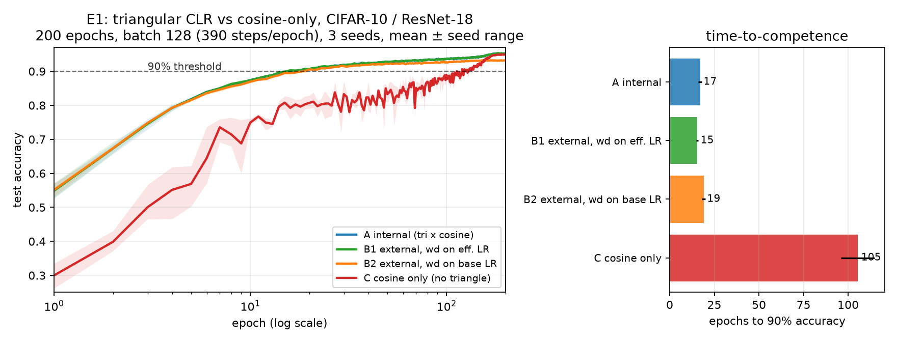

# E1 results (200 epochs) — the scheduler works on time-to-competence

Run: CIFAR-10 / ResNet-18, **200 epochs**, batch 128 (390 steps/epoch), full
50,000-image train set, evaluation on the official 10,000-image **test** split,
`device=cuda`, 3 seeds, 43.8 s/epoch (~2.4 h per run).

Schedule under test (`configs/cifar.json`): `lr(t) = cosine(epoch, T=200) x
triangle(step_in_epoch; period=390)`, with `lr_max=0.8`, **`lr_SWR=1000`**
(so `lr_min=0.0008`), `end_ratio=1e-4`, momentum 0.

## 1. Implementation gate: A == B1 (passes)

| | value |
|---|---|
| B1 − A, final accuracy | **+0.037 pp** |
| paired t (df=2) | **0.16** — indistinguishable |
| final acc, A / B1 | 0.9522 ± 0.0015 / 0.9525 ± 0.0025 |

The internal optimizer and the stock-SGD + external-schedule composition agree
at 200 epochs, as they did in float64 unit tests. **The implementation is
faithful**, so any difference between arms below is real behaviour, not a bug.

## 2. Final accuracy (test split)

| arm | s0 | s1 | s2 | mean | sd |
|---|---|---|---|---|---|
| A_internal | 0.9537 | 0.9508 | 0.9520 | **0.9522** | 0.0015 |
| B1_external_wd_eff | 0.9497 | 0.9544 | 0.9535 | **0.9525** | 0.0025 |
| B2_external_wd_base | 0.9301 | 0.9325 | 0.9326 | 0.9317 | 0.0014 |
| C_cosine_only | 0.9499 | 0.9487 | 0.9492 | 0.9493 | 0.0006 |

Paired by seed, n=3, |t| ≥ 4.30 needed for p<0.05:

| comparison | mean diff | t | seeds won |
|---|---|---|---|
| B1 − A (equivalence) | +0.04 pp | 0.16 | 2/3 |
| B1 − C (triangle vs cosine) | +0.33 pp | −1.84 | 2/3 |
| B1 − B2 (wd coupling) | **+2.08 pp** | **+31.2** | **3/3** |

**On final accuracy the triangle is not significantly better than cosine-only**
(+0.33 pp, t=−1.84). It is also not worse. Both land ~95%.

## 3. Time-to-90% — this is where the effect is

| arm | epochs to 90% (mean of seeds) | raw per seed |
|---|---|---|
| **A_internal** | **17** | 18, 16, 17 |
| **B1_external_wd_eff** | **15** | 15, 16, 15 |
| B2_external_wd_base | 19 | 20, 19, 18 |
| **C_cosine_only** | **105** | 98, 116, 102 |

**The triangular schedule reaches 90% in ~15–17 epochs; cosine-only needs ~105.
That is a 6–7x difference, with equal final accuracy.**

Robustness checks, because "measured at the epoch boundary" can be a
favorable-phase artifact (the triangular wave ends each epoch at its *minimum*
LR, and Smith recommends reporting at exactly that point):

| check | A | B1 | B2 | C |
|---|---|---|---|---|
| raw | 18 | 15 | 20 | 98 |
| 5-epoch moving average | 19 | 18 | 21 | **127** |
| best accuracy in first 20 epochs | 0.9106 | 0.9105 | 0.9066 | 0.8290 |
| best in first 100 epochs | — | — | — | 0.9086 |

The gap survives smoothing and best-so-far, so it is not an evaluation-timing
artifact. Cosine-only is also visibly **erratic** (see figure): accuracy swings
between 0.78 and 0.90 across epochs 20–120. At a constant learning rate near 0.8
the weights move a lot every epoch, so each snapshot catches the model at a
different point.

## 4. The confound that must be closed before claiming "oscillation"

The two families do **not** have the same average learning rate:

| family | mean LR | RMS LR | peak (epoch 0) |
|---|---|---|---|
| A / B1 / B2 (triangle) | **0.2002** | **0.2830** | 0.800 |
| C (cosine only) | **0.4000** | **0.4899** | 0.800 |

The triangular arms average **half** the LR. So E1 cannot distinguish:

* (a) oscillation helps, from
* (b) a lower mean LR helps, and the triangle is one way to get one.

Cosine-only at a constant LR near 0.8 is also a **poorly tuned** baseline — 0.8
is too high to settle, which is why its curve is noisy and slow. A well-tuned
constant-LR baseline at 0.2 might also reach 90% quickly.

**Required control (E2):** constant LR at **0.200** (mean-matched) and **0.283**
(RMS-matched), same 200 epochs / 390 steps / seed budget. Until then the
time-to-90 result is consistent with your claim but does not establish it.

## 5. B2: weight-decay coupling is confounded with decay strength

B1 (decay against the effective LR, mean 0.20) beats B2 (decay against base LR
0.8) by 2.08 pp, 3/3 seeds, t=31. But B2's decay is **2x stronger** on average
because it multiplies the base LR. So this is "less decay is better here", not
evidence that the coupling itself is good. To separate, rerun B2 with
`weight_decay` halved so effective decay matches B1.

## 6. Relation to the sgd_jumper benchmark

| | epochs to 90% | final |
|---|---|---|
| benchmark Jumper (lr .8, mom 0, SWR 10) | 15 | 95.40 |
| benchmark AdamW (lr 1e-3) | 20 | 94.06 |
| benchmark SGD (lr .1, mom .9, cosine) | 101 | 95.53 |
| **this run, A/B1 (SWR 1000)** | **15–17** | **95.2–95.3** |

The pattern reproduces: triangular-fast, cosine-baseline-slow, final accuracy
comparable to well-tuned SGD. Note this run uses `lr_SWR=1000` rather than the
benchmark's 10, and standard CIFAR normalization (0.247) rather than 0.202, so it
is a close replication, not an exact one.

## 7. What this experiment does NOT establish

* **No AdamW arm.** The headline claim ("SGD + scheduler beats any optimizer") is
  not tested here; the numbers above are all SGD, momentum 0.
* **No constant-LR control** (section 4) — the central confound.
* **No period or amplitude sweep.** Period is fixed at one epoch.
* **No baseline at a properly tuned LR.** Cosine-only at 0.8 and the benchmark's
  SGD at 0.1 are both off-optimum, for opposite reasons.

## Files

* `results/e1_summary_cifar.json` — all 12 runs, with per-epoch `val_history`
* `docs/fig_e1_curves.png` — figure above (`scripts/plot_e1.py`)
* `scripts/analyze_tt90.py` — time-to-threshold table
