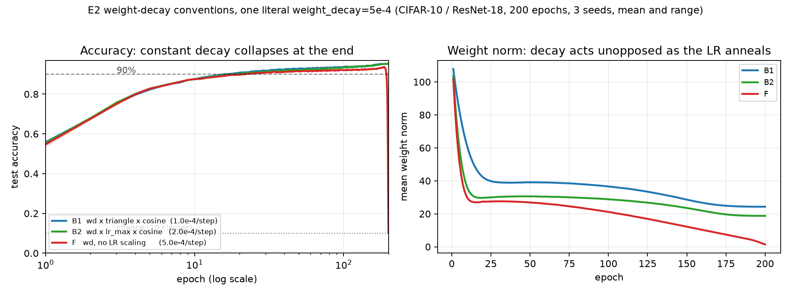

# E2 results — weight-decay convention

CIFAR-10 / ResNet-18, **200 epochs**, batch 128 (390 steps/epoch), full 50k train,
10k test evaluation, 3 seeds, one literal `weight_decay = 5e-4` for every arm.
The arms differ only in what the coefficient multiplies.

| arm | decay factor | mean shrink/step |
|---|---|---|
| B1 `wd × triangle × cosine` | oscillating **and** annealed | 1.0e-4 |
| B2 `wd × lr_max × cosine` | smooth **and** annealed | 2.0e-4 |
| F `wd` | constant | 5.0e-4 |

## Results

| arm | peak acc | @ep | first 90% | final acc | final loss | wnorm@50 | wnorm@end |
|---|---|---|---|---|---|---|---|
| B1 effective | 0.9526 | ~190 | **16.7** | 0.9519 | 0.194 | 39 | 24.3 |
| B2 base | **0.9534** | ~196 | 18.3 | **0.9522** | 0.186 | 30.6 | 18.7 |
| F none | 0.9361 | ~186 | 21.0 | **0.1030** | **2.3022** | 26.9 | **1.5** |
| C cosine-only (E1 run) | 0.9503 | — | 105.3 | 0.9493 | 0.194 | 41 | 22.9 |

### 1. Oscillation buys nothing over smooth annealed decay

Paired by seed (n=3, |t| >= 4.30 for p<0.05):

| metric | B1 | B2 | diff | t | seeds won |
|---|---|---|---|---|---|
| peak | 0.9526 | 0.9534 | **+0.077 pp** | **0.91** | 2/3 |
| final | 0.9519 | 0.9522 | **+0.033 pp** | **0.24** | 2/3 |

**B1 and B2 are statistically indistinguishable.** The intra-epoch triangular
pulsing of the weight decay contributes nothing once the decay anneals with the
learning rate. B2 is nominally ahead on both means.

### 2. Constant decay destroys the model

F is at chance by the last epoch: final accuracy 0.1085 / 0.1000 / 0.1005 across
seeds, and final loss **2.3022 for all three seeds** — `ln(10)`, i.e. exactly the
entropy of a uniform prediction over 10 classes. The network has been driven to
outputting a constant.

The collapse is abrupt and confined to the tail (seed 0):

| epoch | 150 | 170 | 185 | 190 | 195 | 198 | 200 |
|---|---|---|---|---|---|---|---|
| val acc | 0.9245 | 0.9303 | **0.9362** | 0.9338 | 0.8645 | 0.5350 | **0.1085** |
| wnorm | 12.2 | 8.3 | 5.5 | 4.5 | 3.2 | 2.1 | **1.5** |

### 3. Mechanism: decay outlives the learning rate

At epoch 199 the schedule's peak LR is ~1.3e-4 of its initial value, so gradient
steps are negligible. F nevertheless removes `5e-4` per step. Over the last 15
epochs (5850 steps) that multiplies the weights by `e^-2.9 ~ 0.05`, which matches
the observed 5.5 -> 1.5. B1 and B2 are protected because their multiplier
**decays to zero with the LR**: at epoch 199 B1's per-step shrink is ~3e-10 and
B2's ~1.6e-7.

So the requirement is: **weight decay must be reduced as the learning rate
anneals, or it eventually destroys the weights.** The triangular coupling
achieves this automatically, but so does the much simpler smooth annealed
variant (B2).

## The confound that is still open

F differs from B1/B2 in **two** ways: it is constant *and* it is 2x / 5x stronger
on average. Two observations point at both:

* F's **peak** accuracy is already 1.65 pp below B1/B2 before any collapse, which
  is consistent with over-regularization throughout — a **strength** effect.
* The **abrupt final collapse**, coinciding with the LR reaching ~1e-7, is a
  **profile** effect.

So we cannot yet attribute the failure to the constant profile alone. The
decisive run is **F with `weight_decay = 1e-4`**, which matches B1's mean shrink
(1.0e-4) while keeping the constant profile:

* if F@1e-4 reaches ~95% and survives, the collapse was a strength artifact and
  the "convention" story is much weaker;
* if F@1e-4 still collapses late (even if later), the constant profile is
  genuinely at fault.

3 runs, ~1 h. This should be run before any claim about conventions.

## What can be claimed now

Safely:

> Coupling weight decay to the learning rate — in either form — prevents the
> terminal weight collapse that an LR-independent coefficient produces under an
> annealed LR schedule. The intra-epoch oscillation is not required; smooth
> coupling is equally effective and simpler.

Not yet:

> that oscillating decay is better than smooth decay (t = 0.9, n.s.);
> that the constant profile is the cause of F's failure (confounded with 5x
> strength).
